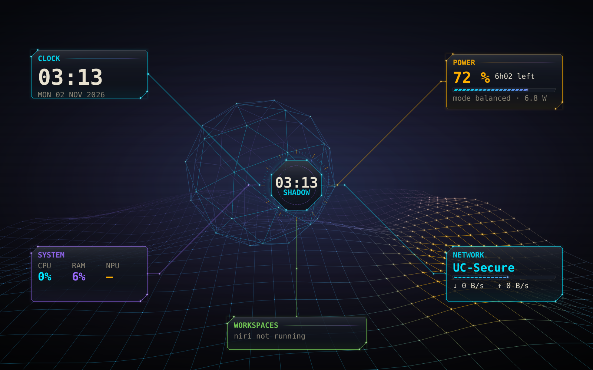
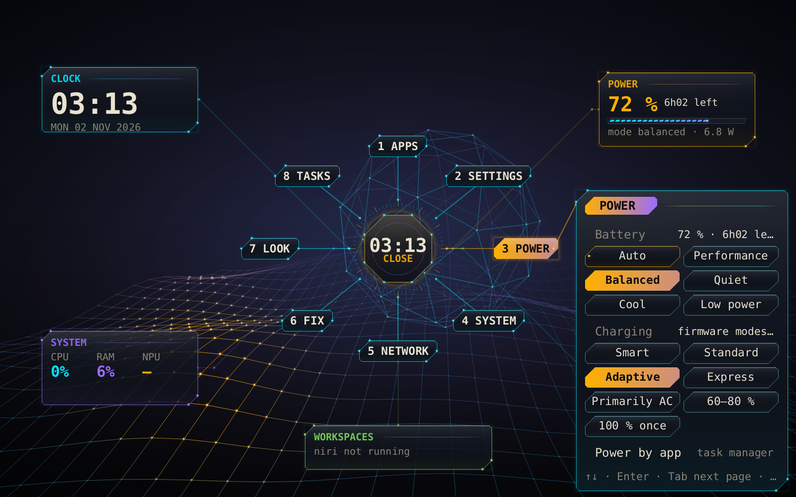
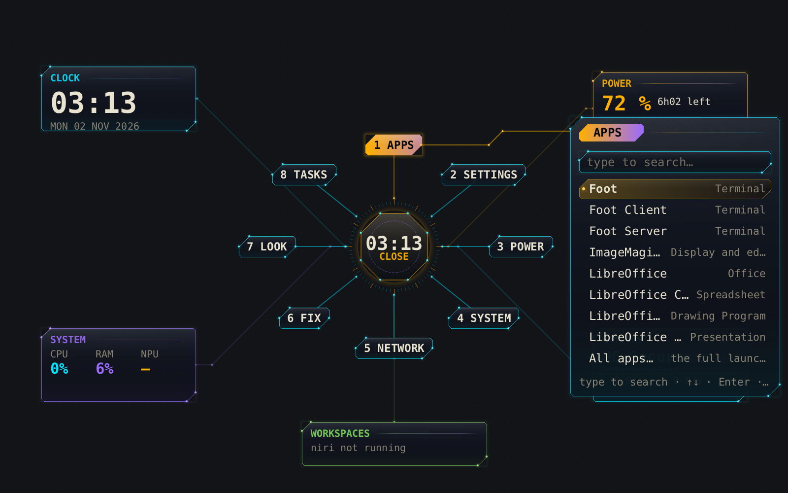

# Shadow TUI Restricted

A keyboard-first tactical desktop for Arch Linux, Fedora and RHEL-family systems, built to the clean-room specification CR-SPEC-SHADOW-001 and tuned for the Dell 14 Plus (2560×1600 panel, Lunar Lake, Arc 140V, Intel NPU).

Shadow runs on **niri** as the compositor. Fedora 44 ships niri in its own repositories. Shadow talks to niri only through its public interfaces (`niri msg --json` and its config file), so niri comes from your distribution and updates on its own. On top sit:

- **8.0:** a vertex wireframe desktop. A 3D wireframe field reacts to the mouse cursor, a static hub sits in the middle of the screen, and floating widgets are wired to it. App windows are glossy translucent glass. See [The hub](#the-hub-80);
- the 7.x floating side bar, still available on request (`Mod+Shift+B`, or `[hub] enabled = false`);
- every feature as its own Rust application with a 2D interface;
- scaling that sets itself per monitor and corrects the text size when it can't;
- a static console login in the style of ly;
- a power daemon whose habit model learns for a week, relearns for a week after every OS update, then keeps adapting.

The Wi-Fi self-repair daemon, the sandboxed self-correcting Lua layer and GitHub state sync carry over. The security subsystem is a separate, optional package.

Version 6, with its own Smithay compositor and orbital ring, stays on the `v6` branch. `docs/SPEC-TRACE.md` lists, requirement by requirement, what is implemented as specified, what differs, and where you changed the spec.

## Components

| Component | What it is |
|---|---|
| `shadow-hub` | **8.0 desktop.** One background-layer surface per monitor, holding:<br>• **Field:** the 3D vertex field, or your wallpaper image.<br>• **Hub:** a static core in the middle of the screen; click it (or press Space) and eight option nodes slide out — APPS, SETTINGS, POWER, SYSTEM, NETWORK, FIX, LOOK, TASKS — each opening a glass panel.<br>• **Widgets:** clock, power, system (CPU/RAM/NPU), network and workspaces, each wired to the core and draggable.<br>`Mod+Space` summons the hub over your windows. See [The hub](#the-hub-80). |
| `shadow-bar` | The floating side bar (layer-shell, right edge), with **APPS · SETTINGS · SYSTEM** buttons at the top. It shows battery % with time left or time to full (smoothed), and the monitor and scale, workspace, focused app, NPU state, sync, battery and watts, panel Hz, package °C and profile, audio DSP, Wi-Fi SSID/dBm/EAP, Lua widgets and the time. It sits on the laptop panel; when docked it follows the monitor that has focus. `Mod+Shift+B` hides it. |
| `shadow-flyout` | The panels behind the side bar's **APPS**, **SETTINGS** and **SYSTEM** buttons. Each opens beside its button; the same button closes it again.<br>• **Apps:** search and launch.<br>• **Settings:** brightness, volume, power mode, Wi-Fi, displays, all settings.<br>• **System:** task manager, update, security console, lock, log out, suspend, reboot, shut down; log out, reboot and shut down need a second press.<br>`Mod+A` opens Apps. Tab switches page; Esc, or moving focus away, closes it. |
| `shadow-tasks` | Task manager (`Ctrl+Shift+Esc`).<br>• **Cards:** CPU (total, per core, frequency), memory (RAM, swap, memory pressure), NPU (busy % from the Intel NPU driver, frequency, learning state), GPU (busy % from xe/i915 idle residency, frequency), power (battery draw, package power, time left, temperature), I/O (network, disk, pressure).<br>• **Processes:** sort with c/m/p, filter with /, end with k (SIGTERM) or K (SIGKILL), each confirmed first. |
| `shadow-fix` | Fix center (`Mod+Shift+H`), with four pages:<br>• **Issues:** known problems of your apps under niri, with repairs.<br>• **Tasks:** clear caches, unlock a Firefox profile, force quit, restart portals or PipeWire.<br>• **Login:** password and login problems.<br>• **Update:** update the system and Flatpaks, then triage. Repairs come after updates, never during them.<br>• **Desktop:** the **solid background colour** on/off, hub or side bar, the hub check, the crash log and the default apps.<br>On a text console the same is `shadow fix …`. |
| `shadow-passfix` | Password repair, a plain text console that works on Ctrl+Alt+F2. See [Fix center](#fix-center-and-password-repair). |
| `shadow-wallpaper` | The wallpaper picker (`Mod+W`). Its first entry is **Vertices**, the reactive 3D field (the default); the second is the generated aurora; then your images. With the hub on, `shadow-hub` draws the wallpaper. With `[hub] enabled = false`, this program draws it instead: on every monitor, also behind the overview, with Vertices as a still frame. |
| `shadow-craft` | The **Craft App Suite** (ArtCraft: PhotoCraft, VectorCraft, FilmCraft, LightCraft, PdfCraft and the rest, 16 apps).<br>• **Install, update, remove, launch** per user, with no password. Apps go to `~/Applications/Craft` with a menu entry, AppImage first, else the tar.gz.<br>• **Checked:** every download is verified against the SHA-256 GitHub publishes for it. Only exact asset names from the app's own repository are used, and an app without a published checksum is not installed.<br>• **Elsewhere:** in the launcher type `+` to list only Craft apps; the hub's APPS panel has "Craft apps…".<br>• **Command line:** `shadow-craft list / install ID / remove ID / update`.<br>The catalog follows the official ArtCraft Launcher (MIT / Apache-2.0). |
| `shadow-compositor` | **Shadow's own compositor (preview)**, the v6 Smithay compositor brought up to date.<br>• **Choose it:** at the login screen ("Shadow TUI Restricted (own compositor, preview)"), or with `[session] compositor = "shadow"`.<br>• **Same desktop:** it starts the hub (or the side bar), uses the same keys, and answers the questions the hub and apps ask niri, so they work unchanged.<br>• **Fallback:** if niri is missing or won't start, the session starts this compositor instead.<br>• **Not there yet:** XWayland, multiple monitors, the standard lock protocol (`shadow-lock` uses the compositor's built-in lock instead) and the niri event stream. |
| `shadow-prefs` | Preferences, with two pages:<br>• **Defaults:** file manager, terminal and background, each applied at once. The file manager sets the XDG folder default and Mod+E. The terminal sets Mod+Return, the terminal apps opened from the hub, launcher and files, and `~/.config/xdg-terminals.list`.<br>• **Crash log:** what is holding changes back (an interrupted update, niri refusing the config, the hub's fallback, waiting `.shadow-new` defaults), then crashes newest first: core dumps of Shadow programs and niri, hub exits, panics, journal errors. Each line has its details below it. `shadow-prefs crash` opens this page.<br>• **Crash reports:** **Save a report** (or `shadow-prefs report` on a text console) writes one plain-text file to `~/shadow-reports/`, for you to attach or upload yourself; Shadow sends nothing anywhere. Your user and computer name, Wi-Fi network names, MAC / IP / e-mail addresses, passwords and tokens are replaced by placeholders, and the file is capped at 1 MB. |
| `shadow-launch` | Launcher, opened as its own normal window (tiled, opaque), not an overlay over what's on screen. Click or press Enter to launch. Its ranking learns what usually follows the app you're in, what you open at this hour, and how often. Each app shows ~RAM and ~W from what it cost before. |
| `shadow-net` | Wi-Fi: networks, UC-Secure and eduroam setup, self-repair, with a live EAP/TLS log. |
| `shadow-config` | Live settings matrix over `config.toml`. Changes apply immediately; if niri rejects one, it is rolled back. |
| `shadow-files` | Three-column file manager (parent · current · preview). |
| `shadow-update` | Updater (`Mod+U`, or "Update" in the launcher). It checks only when you click **Check for updates**, and installs only when you click **Update**. Only the files that changed are replaced. See [Updates](#updates). |
| `shadow-lock` | Session lock (ext-session-lock): one static screen per monitor, PAM. |
| `shadow-term` | The terminal (amber/cyan, HUD strip, command blocks). |
| `shadow-greet` | Static console login for greetd, with no animation, power buttons or command hints. The console font is sized to the panel. |
| `shadow-sessiond` | Session event hub. It turns niri's event stream into telemetry for shadow-powerd, hosts the Lua layer (window rules, bar widgets, key macros) and records per-app memory. |
| `shadow-displayd` | Monitors: automatic scale per monitor, text-size correction, 120/60 Hz on AC/battery, dock mode on lid close, idle lock and monitor power-off. |
| `shadow-powerd` | Power daemon (root): platform profile, EPP, RAPL PL1/PL2, charge limits, kernel guard, the learning schedule and predictive tuning, and the 20 % memory ceiling. As `shadow-audiod`: the Lunar Lake audio initialiser. |
| `shadow` | System tools. As `shadow-netd`: the Wi-Fi self-repair daemon. As `shadow-sync`: state and GitHub sync. As `shadow-healer`: Lua self-correction. Also `setup` (including `setup niri`), `greeter`, `wifi`, `ai` and `update`. |
| `shadow-sec` | The optional package `shadow-tui-sec`: security modules you enable one at a time. |

Every Shadow app renders on the CPU into shared memory and repaints only when something it shows changes, so an idle desktop draws 0 frames. Each one uses a few MB (the bar about 7 MB, a terminal about 20–30 MB). No app uses a GPU API. niri composites with OpenGL ES, and the whole session is pinned to OpenGL. The Arc 140V runs on Intel's `xe` kernel driver with Mesa `iris`; GTK and Qt apps are kept off Vulkan.

## Install

One installer covers Arch Linux, Fedora and the RHEL family (RHEL, CentOS Stream, Rocky, Alma, Oracle Linux, versions 9 and 10). It installs every dependency, builds a native package (pacman on Arch, RPM elsewhere) and installs it, so updates and removal go through the normal package manager.

```bash
git clone <this repo> && cd shadow-tui-restricted
./install.sh                    # dependencies, build, package, install, account setup
./install.sh --greeter --sec    # also the login screen and the optional security package
./install.sh --dry-run          # print every command it would run, change nothing
./install.sh --check            # verify an existing installation (✓ / ~ / ✗ with fixes)
./install.sh --bootstrap git@github.com:you/shadow-state.git   # new machine: restore your state too
./install.sh --uninstall
```

The checkout's folder path may only hold letters, digits and `. _ - + /`. A second download such as `shadow-tui-restricted (1)` or `… - Copy` is refused before anything changes, and the installer prints the exact `mv` command to rename it. Packaging tools paste that path into shell scripts, where a bracket or space breaks the build. `--check` and `--uninstall` work from any folder.

If a build fails, the compiler's own error is printed and the full log is kept in `~/.local/state/shadow-tui/build-rpm.log` (Fedora/RHEL).

What it does on each system:

| | Arch | Fedora 41+ | RHEL family 10 | RHEL family 9 |
|---|---|---|---|---|
| Extra repositories | — | — | CodeReady Builder + EPEL 10 | CodeReady Builder + EPEL 9 |
| niri | `extra/niri` | Fedora's `niri` | `yalter/niri` COPR (falls back to a source build) | built from source (`--niri-ref`, default v25.08) into `/usr/local` |
| Rust ≥ 1.89 | `rust` | `rust` / `cargo`, else rustup | `rust` / `cargo`, else rustup | `rust` / `cargo`, else rustup |
| Package | `makepkg` → `pacman -U` | `rpmbuild` → `dnf install` | `rpmbuild` → `dnf install` | `rpmbuild` → `dnf install` |
| Login screen (`--greeter`) | `greetd`, `terminus-font` | `greetd`, `greetd-selinux`, `terminus-fonts-console` | greetd built from source, run in the display-manager SELinux domain; or keep GDM | same as 10 |

rustup is only used, after asking, when the distribution's Rust is older than 1.89. It installs into `~/.cargo`, and `rustup self uninstall` removes it.

**Safeguards.** The installer stops before changing anything that would leave a half-working system:

- **Pre-flight.** It checks the CPU architecture and refuses image-based Fedora Atomic / Silverblue. It also checks sudo access, at least 5 GB free (10 GB when niri or greetd are built from source), and on RHEL that the system is registered (CodeReady Builder needs it).
- **Required packages.** All of them are checked against your enabled repositories before any is installed. A missing one is named, with the repository that normally provides it.
- **Build requirements.** These are installed straight from the RPM recipe (`dnf builddep`), exactly as `rpmbuild` will check them.
- **niri version.** niri must be at least 25.08, the release the generated config is validated against. An older package is upgraded, or replaced by a source build if you agree.
- **Source builds.** Every binary built from source must run and resolve all its libraries before it is installed.
- **greetd on RHEL.** A failed greetd build never ends the installation; your current login manager stays. Under enforcing SELinux, a greetd that couldn't get its display-manager label is not enabled, because it could not log you in.
- **Verification.** The installation ends with a check, which you can also run any time with `./install.sh --check`. It looks at:
  - the package and all 12 programs;
  - niri and whether it accepts your generated config;
  - the session entry;
  - the lock screen's PAM stack;
  - services, fonts, Mesa EGL and NetworkManager;
  - SELinux labels;
  - when enabled, the login screen (greetd, its user, its self-test, its SELinux label).

  Each item shows ✓ / ~ / ✗ with the command that fixes it.

Optional extras the repositories don't carry are skipped with a note: `age`, `gh`, `alsa-sof-firmware`, CJK fonts, the Terminus console font and so on. RHEL-family systems have no Terminus console font, so the login screen keeps the default console font size there.

On RHEL without `--greeter`, GDM stays. Pick **Shadow TUI Restricted** from the gear menu on its login screen.

**Testing on Fedora / RHEL.** `tests/distro-test.sh` runs the real installer in throwaway containers (podman or docker): Fedora 43, AlmaLinux 10 and Rocky Linux 9 by default, or any images you name. In each one it does a dry run, the full install and `--check`, then prints a pass/fail summary. Logs go to `test-results/`.

Containers can't show the graphical session, running services, greetd at boot or SELinux enforcement. Test those in a VM: RHEL itself (the free developer subscription works), Rocky or Alma, with `./install.sh --greeter` and then a login.

Other entry points:

- `packaging/build-rpm.sh OUTDIR` builds the RPMs on their own.
- `makepkg` builds the Arch package.
- Both packages lay out their files through `packaging/install-files.sh` and share their install scripts (`packaging/post-install.sh`).
- Later updates: the `shadow-update` app replaces only the files that changed (see [Updates](#updates)); `shadow update run` still rebuilds and reinstalls the whole package.

After that, pick **Shadow TUI Restricted** at the login screen, or run `shadow-session` from a TTY.

Shadow's niri config is generated into `~/.config/shadow-state/niri.kdl`, and the session starts niri with `-c`. A plain niri setup in `~/.config/niri` is never touched.

**Upgrading from 6.x.** The orbital-ring compositor, `shadowctl` and the `sakura` text apps are replaced. Your `config.toml` keeps working: old keys are ignored and new ones have defaults. Run `sudo shadow greeter enable` once to switch the login screen.

## Keys

| Keys | Action |
|---|---|
| `Mod+Tab` / `Mod+J` · `Mod+Shift+Tab` / `Mod+K` | focus the next / previous window; the focused window is always centered (120 ms) |
| `Mod+[` / `Mod+]` | width preset 45 / 65 / 85 % |
| `Mod+F` · `Mod+Shift+F` | full width (the bar stays visible) · true fullscreen |
| `Mod+Space` · `Mod+A` | summon the hub over your windows (press again or Esc to close) · the hub's APPS panel |
| `Mod+Return` `Mod+D` `Mod+E` `Mod+N` `Mod+Comma` `Mod+U` | terminal, launcher, files, network, settings, updates |
| `Ctrl+Shift+Esc` | task manager |
| `Mod+Shift+H` · `Mod+W` | fix center · wallpaper picker |
| `Mod+Ctrl+arrows` · `Mod+Shift+Ctrl+arrows` | focus another monitor · move the window there |
| `Mod+1…9` · `Mod+Shift+1…9` | workspace · move the window to a workspace |
| `Mod+O` | overview |
| `Mod+Shift+B` | the optional side bar: start it, then hide / show it |
| `Mod+Alt+L` | lock |
| `Mod+Shift+Backspace` | revert the healer's last automated fix |
| `Mod+Q` · `Mod+Shift+E` | close · quit the session |

With `[hub] enabled = false`, the 7.x keys come back: `Mod+Space` opens the launcher and `Mod+A` the side bar's apps flyout.

Media and brightness keys also work on the lock screen. Lua modules can add key macros; the core binds always take precedence. The pointer hides while you type and after 3 s idle.

## Scaling and monitors

`shadow-displayd` gives every monitor the scale that suits its real pixel density as soon as it is connected. It uses quarter steps, with a closer viewing distance assumed for laptop panels.

| Monitor | Scale |
|---|---|
| Dell 14 Plus panel | 1.5 |
| 27" 4K | 1.5 |
| 32" 4K | 1.25 |
| 27" 1440p | 1.0 |
| 24" 1080p | 1.0 |

To pin a different scale, set it in `[display.scale]`, for example `"DP-1" = 1.25`, or in shadow-config → Displays.

If the scale a monitor ends up with still differs from the ideal (a pinned value, an EDID quirk, a compositor that ignores the request), the text size is corrected instead:

- Shadow apps do it themselves.
- GTK apps get `text-scaling-factor`.

Every app renders at the exact fractional scale (`wp_fractional_scale_v1` + `wp_viewporter`), so text stays sharp at 1.25 or 1.5. `shadow-displayd status` shows what was decided for each monitor.

**Dock mode.** Closing the lid with an external monitor on turns the panel off instead of locking, and opening it turns the panel back on. The side bar moves to whichever monitor has focus.

## Updates

### Update source (required)

Updates come only from one repository you set up. Until it is set up and meets the policy below, nothing can be checked, fetched or built.

`./install.sh` runs the setup:
- it uses `--update-repo URL`, or this checkout's origin by default;
- later, run `shadow update setup` again, or press **Set up update source** in the Update app.

The setup does four things:

1. It creates a dedicated SSH deploy key, `~/.config/shadow-state/update-deploy-key` (mode 600).
2. It shows you the key so you can add it to the repository **read-only**. With `gh` logged in it can do this for you: `gh repo deploy-key add` adds keys read-only unless `--allow-write` is given. Otherwise: repository → Settings → Deploy keys → Add, and leave "Allow write access" unchecked.
3. It pins the server's SSH host key. GitHub's published keys are built in. Any other server's fingerprint must be confirmed, interactively or with `--host-fingerprint SHA256:…`.
4. It saves the repository, branch and auth method (no secret), then checks the policy.

The policy (`shadow update policy` shows it; every fetch enforces it):

| Rule | Default |
|---|---|
| Only ssh or https. http:// and git:// are refused. A local path is allowed as a mirror. | always |
| No token or password in the URL or in `config.toml`. `credential.helper=store` (a plain-text token file) is refused too. | always |
| Authentication: read-only deploy key (SSH), or your credential helper for https (`gh auth setup-git`, libsecret). Use a fine-grained token with read-only *Contents* access for this one repository. | `auth = "deploy-key"` |
| Host key pinned; an unknown or changed key fails closed. | always (ssh) |
| The repository must be private: a credential-free probe that succeeds means it's public, and updates are refused. | `require_private = true` |
| History may not be rewritten: the new head must descend from the installed commit. | `allow_history_rewrite = false` |
| Every new commit is signed by a key in `update-allowed-signers` (git's SSH allowed-signers format). | `require_signed = false` |

Git runs isolated for updates:
- No system or global git config and no `GIT_CONFIG_*` variables apply, so a `url.insteadOf` rewrite can't silently redirect the source.
- Hooks, submodules and file:// are off (file:// stays on for a local mirror).
- Every object received is fsck-checked, TLS verification is forced on, and nothing prompts.

Fetching and building run as you. The administrator step only copies files that are already built.

### Checking and installing

Nothing checks for updates in the background. Open **Update** (`Mod+U`, or from the launcher) and:

- **Check for updates** fetches your repository (Settings → Updates). It lists the new commits, the changed source files and which programs they affect.
- **Update** does the following:
  1. It rebuilds incrementally: cargo recompiles only the crates that changed, then runs their tests.
  2. It lays the result out exactly as the package would.
  3. It compares that, byte for byte, with what is installed.
  4. It replaces only the files that differ. Files a newer version no longer ships are removed.
  5. It asks for your password once, if sudo needs it.
  6. Each file is swapped atomically, and a backup of everything touched goes to `/var/lib/shadow-tui/update-backup` (the last 3 are kept).
  7. Only the services and session programs whose binaries changed are restarted.
- **Undo last update** restores that backup.

Safeguards:

- **Config files in `/etc` are never overwritten.** When a shipped default changes, the new version is placed next to yours as `FILE.shadow-new`. If you've edited your copy and the default didn't change, nothing is offered.
- **New dependencies need the package manager.** If an update adds or drops a package dependency, the updater refuses it and tells you to run `./install.sh`.
- **Failures change nothing.** If the build or the tests fail, nothing is installed. If writing a file fails partway through, every file already changed is put back.
- **The desktop can't start on a half-updated system.** While an update, undo or package install is writing files, `/var/lib/shadow-tui/update-in-progress` exists. It is removed only once everything is on disk.
  - While it exists, the login screen refuses to start a session ("system update in progress — login paused"), and so does `shadow-session` from a TTY. A session that is already running keeps running.
  - Shutdown, suspend and lid-suspend are held off for the duration (`systemd-inhibit`).
  - The marker is also a lock, so two updates can't run at once.
  - If an update is cut off (power loss, crash, forced reboot), `shadow-update-recover.service` repairs it at the next boot, before the login screen and before any login (TTY and ssh included). It reverses a file-level update from its backup journal. It finishes an interrupted package install from the package file, then checks the result against `MANIFEST.sha512`.
  - If recovery can't succeed, the desktop stays locked. Log in on a text console and run `sudo shadow update recover` or `./install.sh`. The Update app offers **Recover interrupted update** too.
  - `./install.sh`, `shadow update run` and `shadow update rollback` install their packages under the same guard.

The same from a terminal: `shadow update check-files`, `shadow update apply`, `sudo shadow update undo`, `sudo shadow update recover`, `shadow update in-progress`.

pacman/rpm keep listing the version you last installed with `./install.sh`. The installed build itself is recorded in `/opt/shadow-tui/share/BUILD_INFO` (`version+gitCOMMIT`). The next `./install.sh` brings the package database back in line.

## Configuration

Settings live in `~/.config/shadow-state/config.toml`. `shadow setup` writes every default as a comment. Edit the file, or use `shadow-config` (`Mod+Comma`), which applies each change live.

The sections:

- `[layout]`: presets, default width, gaps, transition time.
- `[look]`: colours, opacity, font, text size.
- `[display]`: refresh policy, refresh rates and `[display.scale]` pins.
- `[defaults]`: `files` / `files_cmd` (file manager) and `terminal_cmd`. Set them with `shadow-prefs`.
- `[hub]`: `enabled` (default true; false brings back the side bar and the wallpaper program), `output` (the monitor that shows the hub), `reactive` (false keeps the field still), and `[hub.widgets]` positions.
- `[bar]`: width.
- `[input]`: XKB layout and options, key repeat.
- `[session]`: lock and monitor-off timeouts.
- `[memory]`, `[power]`, `[updates]` and `[sync]`.

Layout, look and input become niri's config through `shadow setup niri`. niri validates the result before it replaces the running config; a rejected change is not applied.

## Login screen

```bash
sudo pacman -S greetd terminus-font && sudo shadow greeter enable   # takes effect at the next boot
shadow greeter preview                                              # try it in any terminal (password: shadow)
```

greetd runs `/opt/shadow-tui/lib/greeter-wrapper`, which starts `shadow-greet` on the console. It shows one static box with two fields, login and password, and an AUTHORIZED ACCESS ONLY line. It has no clock, animation, session menu, power buttons or command hints.

The console font is chosen from the panel's EDID, so the box is the same physical size on any screen: `ter-v24n` on the 2560×1600 panel, `ter-v16n` on a 1080p screen. Set `console_font` in `/etc/shadow-tui/greeter.conf` to `off` or to a font name to override it. If the greeter can't start, greetd's own `agreety` prompt appears instead.

## Power and the NPU

`shadow-powerd status | mode | learn | charge | rapl | memory | kernel | audio | npu`

**Learning schedule.**

- **First week.** For the first 7 days the model only watches and fits quickly. Power stays on the firmware defaults plus the AC/battery policy, and the bar shows `LEARNING d/7`.
- **After the week.** Its predictions drive the power settings:
  - light work on battery: PL1 9 W, EPP `power`, profile `cool`;
  - heavy work: the firmware limits come back before the load arrives.
- **Dynamic self-learning.** Learning continues slowly, and apps it hasn't seen still learn fast.
- **OS update.** A completed `pacman -Syu` or a new kernel starts a fresh 7-day relearn (`reason: os update`). Installing a single package does not.
- **Drift.** If predictions keep missing (error above 25 % over 40+ samples), a 2-day relearn starts.
- **Commands.** `shadow-powerd learn` shows where it is; `shadow-powerd learn --relearn` starts a fresh week.

**How it works.** Every focus change in niri sends the spec's 32-byte telemetry record. The model is a per-app statistical table that runs on the CPU in microseconds. The NPU is reserved for the local language model (`shadow ai`, `shadow-healer`).

**Refresh rate.** The panel runs at 60 Hz on battery and 120 Hz on AC. `shadow-displayd` switches the mode through niri.

**Memory ceiling.** niri and the Shadow apps (user `shadow.slice`) plus the daemons (system `shadow.slice`) are capped at 20 % of RAM in total. Everything you launch runs in `app.slice`.

## Wi-Fi (UC-Secure / eduroam)

`shadow-net` (`Mod+N`), or:

```bash
shadow wifi campus ucalgary --user jane.doe
```

The root daemon `shadow-netd` keeps the card usable and repairs failed connections step by step:

- legacy TLS: `SECLEVEL=1`, then `SECLEVEL=0`, scoped to that network;
- PEAP version toggle with a CA reload;
- MAC randomisation off;
- ARP flush and lease renew;
- connected but no internet: DNS-over-TLS fallback.

Password failures are never retried more than once. The side bar shows the SSID, signal (dBm) and EAP/TLS state, and `shadow-net` streams each connection's EAP/TLS phases live. For the iwd backend, `shadow wifi iwd-provision` writes the `.8021x` files.

## Self-correction

Behaviour scripts live in `/var/lib/shadow-tui/modules/*.lua`, a git repository. They run in a sandboxed LuaJIT with no `os`, `io`, `debug` or loaders and a time budget.

When a module throws an error, `shadow-healer`:

1. waits until no person has edited the file for 30 seconds;
2. sends the module and the sanitised error to the local model;
3. checks the reply's AST against a capability whitelist;
4. dry-runs it in a network-less sandbox as `nobody`.

By default a passing fix waits for `sudo shadow-healer approve N`. With `mode = "auto"` in `/etc/shadow-tui/healer.toml` it is committed automatically, and `Mod+Shift+Backspace` undoes it. A fix that fails the checks is discarded and the module goes back to its last known-good commit. The healer never touches binaries. Fixes to the Rust code go through `shadow ai propose` / `review` / `approve`: a full package build with every test, and only when you type APPROVE.

## State on GitHub

```bash
shadow-sync init --github shadow-state     # creates a PRIVATE repo (gh auth login first)
shadow-sync push                           # or: shadow-sync auto on  (daily)
shadow-sync bootstrap git@github.com:you/shadow-state.git   # on a wiped machine
```

The repository holds:

- `config.toml`;
- `npu_weights.bin` (the learned tables);
- `healed_patches/`;
- `secrets.age` (Wi-Fi credentials, encrypted with age to your SSH key);
- package and service lists.

Plaintext secrets are refused by a scanner. The side bar shows the sync state.

## Fix center and password repair

The issues come from what niri, Hyprland and sway users run into most. Each detected problem has a repair:

| Area | Problem → repair |
|---|---|
| Session | No polkit agent → install one. X11-only apps (Steam, games) → xwayland-satellite. Screen sharing and file pickers → xdg-desktop-portal-gnome + gtk. Notifications vanish → mako, started by the session. Keyring not unlocked at login → `optional` pam_gnome_keyring lines in `/etc/pam.d/greetd` (can't block a login; backup kept). Light GTK apps → dark colour scheme. Java apps open grey and Qt apps without the Wayland plugin crash → the session sets `_JAVA_AWT_WM_NONREPARENTING=1` and `QT_QPA_PLATFORM="wayland;xcb"`. |
| Discord | The "update available, download" loop of distro packages → `SKIP_HOST_UPDATE`. Closing hides it in a tray niri doesn't have → `MINIMIZE_TO_TRAY: false`. Native Wayland and PipeWire capture → launcher override. Screen sharing from the Discord app stays limited on Wayland; the browser or Vesktop share reliably. |
| VS Code | "OS keyring couldn't be identified" → `"password-store": "gnome-libsecret"` in `argv.json` (comments kept). |
| Chrome / Chromium / Brave / Vivaldi / Edge | Wayland plus keyring flags, through a launcher override. |
| Firefox | VA-API hardware video decoding (and whether Intel's driver is installed). Portal file dialogs. |
| Steam | UI scaling on a HiDPI panel. |
| Spotify / Slack / Obsidian | Native Wayland. |
| Flatpak | Wayland socket and GTK theme overrides. |

How the repairs are made:
- **Your own files only.** User-level repairs edit only your files and keep a `.shadow-bak` copy.
- **Launcher overrides.** Overrides are copies in `~/.local/share/applications`, marked with the system file's age. When an update changes the app's launcher, the override shows up as stale and is refreshed. Overrides you wrote yourself are never replaced.
- **System repairs.** Repairs that change the system ask for your password through sudo.

**After updates, not during them.** Shadow uses no package-manager hooks. The triage runs at the next login when the package database changed (you get a notification), or right after `shadow fix update`. It lists:
- apps whose version changed;
- launchers that went stale;
- caches to clear. Electron apps (Discord, VS Code, Chrome) and Firefox are known to show blank or broken windows when an update leaves an old cache behind.

You pick what to fix: all, only what needs no password, or by number.

**Password repair (`shadow-passfix`)** checks the usual causes of "my password doesn't work":
- a `pam_faillock` lockout: 3 wrong passwords lock the account for 10 minutes on Arch, Fedora and RHEL, and even the right password then fails;
- Caps Lock and Num Lock;
- the text-console keymap differing from the desktop layout;
- missing or broken PAM files (restored from the shipped copies);
- an expired password or account;
- membership of `wheel`;
- fingerprint-first PAM stacks;
- a login keyring that still expects your old password.

It can test your password through the `shadow-passtest` PAM service. That service has no faillock, so testing can't lock you out. Repairs that need root go through sudo. If sudo is locked out by the same counter, it tells you that the counter lives in `/run` and clears at reboot.

The lock screen now shows PAM's own messages (for example "account locked due to 3 failed logins") and a Caps Lock warning.

## Power and smart charging (side bar)

**POWER ▾** in the side bar opens three sections:
- **Mode:** auto, performance, balanced, quiet, cool, low-power.
- **Charging:** the modes this battery's firmware offers, plus Smart and 100 % once.
- **Apps:** the programs drawing the most power right now, in watts when package power is known.

On Dell laptops (kernel `dell-laptop` driver) the charging modes are:

| Mode | Firmware mode |
|---|---|
| Standard | Standard |
| Adaptive | Dell's own learning |
| Express | Fast |
| Primarily AC | Trickle |
| 60–80 % | Custom |

**Smart** charging picks from those modes using how much of the last 7 days you spent on AC:
- mostly plugged in (≥ 80 %) → 60–80 %, or Primarily AC if Custom isn't offered;
- mixed use → Adaptive, or Standard.

The choice is re-evaluated at most once a day. **100 % once** charges fully for travel, then returns to your mode.

Charging settings live in the BIOS's non-volatile memory, so Shadow is deliberately careful:
- only modes the firmware itself lists are written;
- thresholds only inside Dell's limits (start 50–95, end 55–100, at least 5 apart);
- nothing is written when the setting is already in effect;
- every write is read back, and a mismatch pauses smart charging;
- at most 6 charging writes in any 24 hours, manual ones included (`shadow-powerd charge` shows the budget).

No vendor tool or raw SMBIOS token is ever used, only the kernel's standard battery interface.

## Permissions and password prompts

Some actions need administrator rights or polkit authorisation. Shadow makes them ask instead of failing:

| Action | How it's authorised |
|---|---|
| Wi-Fi system fixes, Wi-Fi device repair | polkit (`org.shadownetwork.*`). The device repair needs no password for the active local user; system fixes ask for the administrator password. |
| Reboot / shut down while something holds an inhibitor, or with other users logged in | logind via polkit. The System flyout shows the reason when it's refused (for example an update writing files) and never overrides the inhibitor. |
| Network connections for all users (RHEL; Fedora allows the active user) | NetworkManager via polkit |
| Ending another user's process in the task manager | offered as "authorise as administrator" (`pkexec kill`) |
| Updates, the security console | sudo, inside the app or the console (the security console always asks again) |
| Brightness | systemd-logind `SetBrightness`, allowed for the active session without root (brightnessctl as fallback) |
| Package power in the task manager | the RAPL counter is root-only; `shadow-powerd` publishes it in `/run/shadow/rapl.state` |

Two things make these prompts work:

- **A polkit authentication agent.** niri has none, and without one polkit can't ask for a password, so pkexec and logind just fail. `shadow-sessiond` starts the first agent installed (mate-polkit, lxqt-policykit, polkit-gnome, lxpolkit, xfce-polkit or polkit-kde), and `./install.sh` installs one. Check it with `shadow-sessiond polkit`.
- **Membership of `wheel`.** On Fedora, RHEL and Arch, sudo and polkit treat that group as administrators. `./install.sh` and `./install.sh --check` warn if your account isn't in it. Fix: `sudo usermod -aG wheel $USER`, then log in again.

## The hub (8.0)



The desktop has four parts:

- **The field.** A 3D wireframe terrain sits under a slowly turning icosphere. It is drawn on the CPU like everything else.
  - The camera leans towards the mouse cursor.
  - The mesh lifts and ripples around the cursor, and its vertices light up from cyan to amber there.
  - A frame is drawn only while the pointer moves over the desktop, plus about 1.5 s of easing.
  - Choose an image instead with LOOK → Wallpaper image… (`Mod+W`). `[hub] reactive = false` keeps the field still.
- **The core.** It sits in the middle of the screen. Click it, or press Space when the desktop has focus, and eight option nodes slide out of it: APPS, SETTINGS, POWER, SYSTEM, NETWORK, FIX, LOOK and TASKS. Clicking a node drops its glass panel open beside the ring.
  - APPS: search as you type.
  - SETTINGS: brightness and volume with − / +, displays, input, all settings.
  - POWER: the power-mode chips and charging chips (below), battery and time left.
  - SYSTEM: lock, suspend, log out, reboot and shut down; log out, reboot and shut down need a second press.
  - NETWORK: Wi-Fi status, traffic, the network manager, the Wi-Fi radio.
  - FIX: fix center, update, password repair.
  - LOOK: Vertices / Aurora / an image, window glass opacity, reset the widget layout.
  - TASKS: CPU, memory and NPU, and the task manager.
- **Keys.** Tab and Shift+Tab walk the panels, and 1–8 jump to one. ↑↓ and Enter work the rows, ← → adjust a value, Esc closes. Typing on the desktop opens APPS with what you typed.
- **Widgets.** CLOCK, POWER (battery, time left, mode, watts), SYSTEM (CPU / RAM / NPU with a CPU trace), NETWORK and WORKSPACES (a chain of vertex nodes from niri).
  - Each floats in glass and is wired to the core by an elbow connector with vertex nodes at the joints, in the Ghost in the Shell hologram style.
  - Drag a widget to move it. Positions are saved in `[hub.widgets]` as fractions of the screen, and `name = "off"` hides one.
  - `shadow-hub reset-layout` puts them back.



**Summon (`Mod+Space`).** The desktop is usually covered by windows, because niri tiles them. So `Mod+Space` opens the hub over everything: an overlay layer with tinted glass on the monitor you are using, the keyboard taken, the ring already open. Esc, the same key again, or a click on empty space closes it. `Mod+A` summons it straight onto APPS.



**If the hub doesn't work.** Three safeguards keep you from an empty desktop:

- **Crashes.** A small supervisor (the same program) runs the hub. It restarts the hub after a crash. After 3 crashes within 2 minutes it starts the side bar and the wallpaper instead, and shows a notification. The details go to `~/.local/state/shadow-tui/hub.log`.
- **Older niri.** If niri rejects one of the newer config lines, `shadow setup niri` drops the optional ones (overview backdrop colour, layer shadow rules) instead of keeping the whole old config. The old config would mean no hub and the 7.x keys.
- **Updating mid-session.** An update that brings the hub starts it right away and retires the side bar and wallpaper, using `shadow-hub switch`. niri already reloaded its config (keys included) live; before 8.0.1 the hub itself only started at the next login.
- **Switching by hand.** `shadow-hub switch` turns the hub on, rewrites niri's config, starts the hub and stops the side bar and wallpaper, all in the running session. `shadow-hub use-bar` does the reverse. Both last across logins.

`shadow-hub doctor` checks, on your machine:
- that niri is reachable;
- that the generated config starts the hub;
- whether the hub and its supervisor are running;
- whether an image is set as the background (an image replaces the 3D field);
- whether a keyboard-layout switch has taken Mod+Space;
- how long a frame takes here.

It also prints the end of the hub log.

### Look

Every 2D app shares the vertex wireframe style:

- chamfered (angle-cut) glass panels with a gloss highlight;
- thin cyan wire edges with glowing vertex nodes at the cut corners;
- a faint dot lattice behind the content;
- angled amber→violet tags;
- segmented meters and wire sparklines that end in a node.

App windows are translucent glass. `[look] window_opacity` sets how much (default 0.86; 1.0 makes them opaque again), and LOOK → Window glass changes it from the hub. The launcher and the updater always stay fully opaque, as asked for in 7.2.

**Solid background colour.** `[look] solid_background` defaults to true, giving a flat obsidian behind the overview (and the workspaces on older niri). With it off, only the hub's field or your wallpaper shows, and black where nothing is drawn. Change it in the fix center (DESKTOP) or in Preferences.

**Blur (niri 26.04).** On niri 26.04 or newer, the glass windows (settings, network, files, task manager, fix center, wallpaper) and the summoned hub get real blur behind them. On older niri, `shadow setup niri` leaves the blur out and keeps everything else.

The other `[look]` options are `chamfer` (cut size, 0–32), `radius`, `violet`, `amber`, `cyan`, `obsidian`, `opacity` (the side bar), `font` and `font_pt`.

**Quality and battery.** The field has three quality levels.
- **high:** 60 fps.
- **battery:** a lighter mesh at 30 fps.
- **low:** half resolution, for slow machines.

With `[hub] quality = "auto"` (the default), it uses high on mains power, battery on battery, and low on weak hardware. Weak hardware means 2 threads or fewer, under 4 GB of RAM, or no 3D-capable GPU. Other savings:
- The widgets refresh every 3 s on mains power and every 10 s on battery, and redraw only when what they show changed.
- The motion settles in about half the time it used to.

Measured at 2560×1600, per frame while the mouse moves:

| Version | Time per frame | One core while moving |
|---|---|---|
| 8.1.1 | 11.8 ms | about 71% |
| 8.2, high | 8.3 ms | about 50% |
| 8.2, battery (30 fps) | 7.4 ms | about 22% |

**Any machine.** `shadow_apps::hw` reads the CPU, threads, memory, GPU driver, battery, virtual machine and WSL. It sets:
- the field quality;
- opaque windows and no blur when nothing renders in 3D (glass and blur would cost CPU on every frame);
- what `shadow-hub doctor` and crash reports show.

Display scaling was already computed from each panel's own size and resolution, so it adapts to any screen.

**WSL (Windows).** In WSL, `shadow-session` detects Windows and runs the compositor as one window on the Windows desktop through WSLg. Choose niri or Shadow's own compositor as usual. It needs WSLg: Windows 11, or WSL from the Microsoft Store on Windows 10.

**Cost.** Everything is drawn on the CPU, as before. The hub draws into its own layer, and that layer is redrawn only when something in it changes: menus, drags, or the widgets' numbers every 3 s. Frames where only the field moves just put that layer back over the field. The figures below are from the container, at about 60 Hz:

| | 1600×1000 | 2560×1600 |
|---|---|---|
| A frame while the field moves | about 5 ms | about 12 ms |
| A full hub redraw (menu animation) | about 25 ms | about 60 ms |
| Idle, nested in niri | about 0.5 % of one core | |

`SHADOW_SNAPSHOT=out.ppm <app>` renders one frame of any app without a compositor, for screenshots. Optional variables:

- `SHADOW_SNAPSHOT_POINTER=x,y` rests the pointer at a point.
- `SHADOW_SNAPSHOT_BENCH=N` times N frames.

The login console uses rounded box-drawing and a gradient beam.

## Optional security subsystem

```bash
./install.sh --sec                # installs shadow-tui-sec, shows what this OS supports, offers the console
shadow-sec precheck               # per module: can it be enabled on this system, and why not
shadow-sec console                # the security console (also: side bar → SYSTEM, or the launcher)
shadow-sec report                 # ITSG-33 control mapping (self-assessment, NOT a certification)
shadow-sec zeroize --plan
```

**Precheck.** A module can only be enabled after its precheck passes on this OS. Examples:

| Module | Checked |
|---|---|
| usb | kernel USB authorisation, Thunderbolt security level |
| zones | nftables tools, kernel nf_tables; notes when firewalld or ufw is also active |
| sandbox | systemd 247 or newer |
| audit | audit tools; kernel booted without `audit=0`; auditd running |
| fss | systemd built with Forward Secure Sealing |
| verity | fsverity-utils; `/opt/shadow-tui` on ext4 with the verity feature, btrfs or f2fs. XFS (the RHEL default) has no fs-verity. |
| crypto | OpenSSH with ML-KEM or sntrup hybrid key exchange |

The precheck also shows the platform's state:
- SELinux / AppArmor;
- kernel lockdown;
- Secure Boot;
- TPM 2.0;
- LUKS disk encryption.

`shadow-sec enable` itself refuses a module whose precheck fails, so nothing is ever half-configured.

**Enabling** is done from the security console, or by `./install.sh --sec`, which opens the console. Never automatically, not even with `--yes`. In the console:
- the module's precheck is shown first;
- you type the module's name to confirm;
- the change runs through sudo with the cached credential cleared (`sudo -k`), so your password is asked every time.

Every enable and disable is logged with the user who made it, in `/var/lib/shadow-sec/events.log`.

Enabling `usb`, `ids` or `zones` also enables the `shadow-sec` service. That service restores the nftables zones at every boot; before this, they were lost on reboot.

Each module states what it actually enforces. The spec items it cannot honestly deliver are listed in `report` and in `docs/SPEC-TRACE.md`, for example eBPF/XDP programs, keystroke biometrics, FIPS-validated modules and TPM attestation.

## Layout of this repository

```
ui/        shadow-ui: the shared 2D toolkit (windows, layer panels, lock surfaces, fractional scale, text correction)
bar/       shadow-bar
apps/      shadow-launch, shadow-net, shadow-config, shadow-files, shadow-lock
desktop/   shadow-sessiond, shadow-displayd
niri/      niri IPC client (niri msg --json), event-stream model, config generator
greet/     shadow-greet (static console login, no dependencies)
term/      shadow-term
powerd/    shadow-powerd / shadow-audiod (learning schedule in schedule.rs)
core/      shadow / shadow-netd / shadow-sync / shadow-healer
lua/       shared LuaJIT sandbox, AST policy, input sanitiser
sec/       shadow-sec (optional package)
modules/   default Lua behaviour modules
system/    units, slices, session, greeter wrapper, hooks, PAM, desktop entries
packaging/ RPM spec, build-rpm.sh, install-files.sh (shared file layout), post-install.sh (shared scriptlets)
tests/     distro-test.sh: the installer in Fedora / Alma / Rocky containers
share/     hardware tables, shell integration
docs/      SPEC-TRACE.md
```

`cargo test --workspace` runs the unit tests. `makepkg` runs them too, validates the generated niri config with `niri validate`, and refuses to package if anything fails.

## Licences

The project is MIT. Third-party crates keep their own licences:

- smithay-client-toolkit, mlua/LuaJIT and ab_glyph: MIT;
- fontdue: MIT/Apache-2.0;
- full_moon: MPL-2.0.

niri (GPL-3.0) is a separate program that Shadow runs and configures; none of its code is part of this repository.
