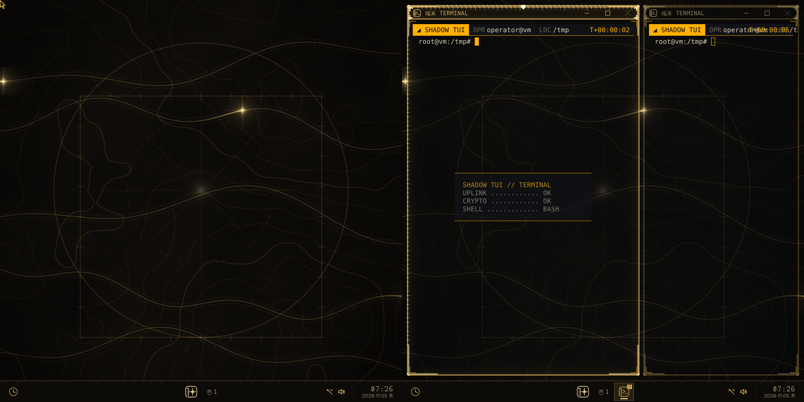
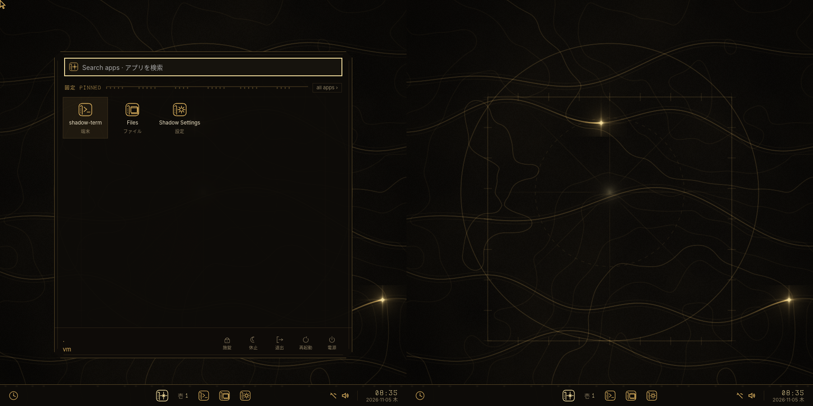
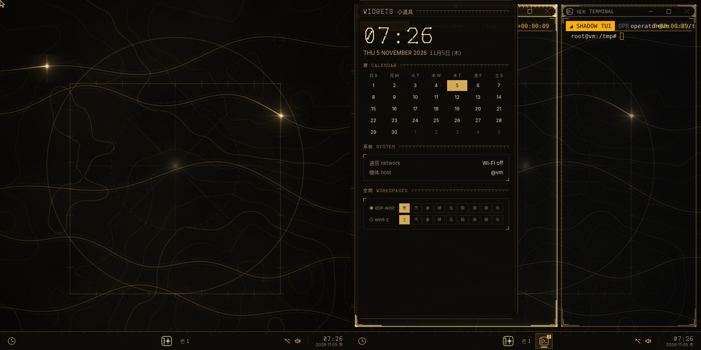
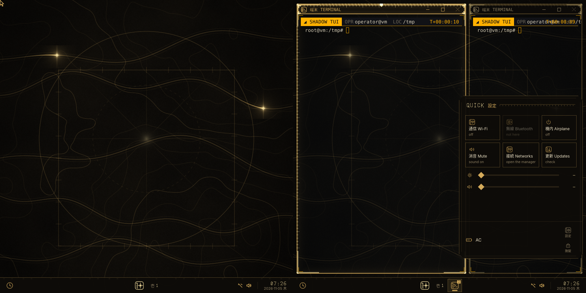
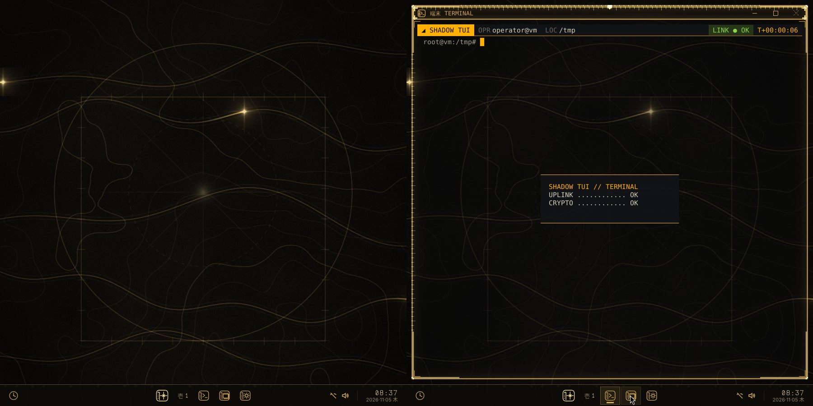

# Shadow TUI Restricted

A keyboard-first tactical desktop for Arch Linux, Fedora and RHEL-family systems, built to the clean-room specification CR-SPEC-SHADOW-001 and tuned for the Dell 14 Plus (2560×1600 panel, Lunar Lake, Arc 140V, Intel NPU).

**10.0 is a Windows 11-style shell on the glyph desktop, on Shadow's own compositor only (niri is gone).** Gold line work on warm obsidian, built on Vitruvian proportions, with alien Shadow Glyph lettering and Japanese labels beside the English ones (設定 SETTINGS, 端末 TERMINAL). See [The 10.0 desktop](#the-100-desktop) and [The glyph desktop](#the-glyph-desktop-90). On top sit:

- **Taskbar:** centred along the bottom of every screen. It holds the start glyph, the workspace, pinned and running apps, the tray (network, sound, battery, update) and the clock. It is a local web page in a frameless WebKitGTK window that doesn't show itself as one.
- **Start menu, widgets, quick settings:** flyouts over the taskbar. Start (`Mod+Space`) has pinned apps, search and power buttons. Widgets (`Mod+W`, from the left) has the clock, calendar, system and every screen's workspaces. Quick settings (`Mod+A`, from the right) has Wi-Fi, Bluetooth, airplane mode, mute, brightness and volume.
- **Title bars:** every window has one, showing its glyph and bilingual label, the title, and minimize · maximize/restore · close. Double-click the bar to maximize; `Mod+Up` / `Mod+Down` do the same from the keyboard.
- **Multiple monitors:** every connected monitor is used, including ones plugged in later. Apps open on the second screen by default. Each screen has nine workspaces.
- **Automatic updates:** from the public repository. A new version is downloaded, built and tested in the background, then offered as "Update ready — install?", installed with one click.
- **App area:** apps tile in the space above the taskbar. Minimized apps stay as before: square tiles in a scrollable strip (or a grid).
- **Kinetic unfolding:** every window opens, closes, minimizes and comes back as a tessellation of cells swinging open or shut. It starts from where the app came from: a side-column row, its grid tile, or the hidden hub.
- **Glyph columns:** the 9.x edge columns and hidden hub remain as the fallback shell (`[shell] mode = "glyph"`, or automatically when the web panels can't start).
- **Background:** contour lines with light travelling along trail lines. It doesn't react to the mouse, and it redraws only where the light passes.
- **Shadow Glyph:** an original display typeface (`assets/fonts`, generated by `tools/font/build_font.py`), and an original glyph icon set.
- **Settings as a web app:** settings, the fix center, default apps, config and the crash log are one installable web app (PWA) served by a local API, `shadow-webd`. It answers only this computer and uses a secret key generated every session.
- **Login screen:** a boot animation, the desktop switch (Shadow and any other installed desktop), a Terminal UI emergency button, and suspend, restart and shut down. Logging out folds the desktop back into the star.
- **Apps:** every feature is its own Rust application with a 2D interface. Scaling sets itself per monitor.
- **Power daemon:** its habit model learns for a week, relearns after every OS update, then keeps adapting.

The Wi-Fi self-repair daemon, the sandboxed self-correcting Lua layer and GitHub state sync carry over. The security subsystem is a separate, optional package.

Version 6, with its own Smithay compositor and orbital ring, stays on the `v6` branch. `docs/SPEC-TRACE.md` lists, requirement by requirement, what is implemented as specified, what differs, and where you changed the spec.

## Components

| Component | What it is |
|---|---|
| `shadow-panel` · `shadow-shell` | **10.0 desktop shell.** `shadow-panel` shows the taskbar on every screen and the start menu, widgets and quick settings flyouts. They are pages from `shadow-webd` in frameless WebKitGTK layer-shell windows: no address bar, context menu, zoom, devtools or navigation away from the local page. `shadow-shell` starts it with the session and falls back to `shadow-glyph` if it can't run. See [The 10.0 desktop](#the-100-desktop). |
| `shadow-glyph` | The 9.x shell: edge columns (left: CHRONO, SYSTEM, POWER, APPS; right: NETWORK, QUICK settings, SETTINGS pages, SESSION) and the hidden hub. It is the fallback, or the shell itself with `[shell] mode = "glyph"`. See [The glyph desktop](#the-glyph-desktop-90). |
| `shadow-webd` · `shadow-settings` | The local API behind the shell pages and the settings web app (settings, fix center, default apps, config, crash log), and the opener of that app. |
| `shadow-tasks` | Task manager (`Ctrl+Shift+Esc`).<br>• **Cards:** CPU (total, per core, frequency), memory (RAM, swap, memory pressure), NPU (busy % from the Intel NPU driver, frequency, learning state), GPU (busy % from xe/i915 idle residency, frequency), power (battery draw, package power, time left, temperature), I/O (network, disk, pressure).<br>• **Processes:** sort with c/m/p, filter with /, end with k (SIGTERM) or K (SIGKILL), each confirmed first. |
| `shadow-fix` | Fix center (`Mod+Shift+H`), with four pages:<br>• **Issues:** known problems of your apps on a tiling Wayland desktop, with repairs.<br>• **Tasks:** clear caches, unlock a Firefox profile, force quit, restart portals or PipeWire.<br>• **Login:** password and login problems.<br>• **Update:** update the system and Flatpaks, then triage. Repairs come after updates, never during them.<br>• **Desktop:** the **solid background colour** on/off, hub or side bar, the hub check, the crash log and the default apps.<br>On a text console the same is `shadow fix …`. |
| `shadow-passfix` | Password repair, a plain text console that works on Ctrl+Alt+F2. See [Fix center](#fix-center-and-password-repair). |
| `shadow-wallpaper` | A layer-shell wallpaper for other desktops (KDE, Sway, Hyprland); Shadow's compositor draws its contour background itself. |
| `shadow-craft` | The **Craft App Suite** (ArtCraft: PhotoCraft, VectorCraft, FilmCraft, LightCraft, PdfCraft and the rest, 16 apps).<br>• **Install, update, remove, launch** per user, with no password. Apps go to `~/Applications/Craft` with a menu entry, AppImage first, else the tar.gz.<br>• **Checked:** every download is verified against the SHA-256 GitHub publishes for it. Only exact asset names from the app's own repository are used, and an app without a published checksum is not installed.<br>• **Elsewhere:** in the launcher type `+` to list only Craft apps; the hub's APPS panel has "Craft apps…".<br>• **Command line:** `shadow-craft list / install ID / remove ID / update`.<br>The catalog follows the official ArtCraft Launcher (MIT / Apache-2.0). |
| `shadow-compositor` | **The compositor (the desktop itself; 10.0: the only one).** The v6 Smithay compositor brought up to date.<br>• **Screens:** every connected monitor, laid out left to right with the laptop panel first; monitors plugged in or out while running are added or removed, and an unplugged screen's windows move to the panel. New apps open on the second screen (`[display] open_apps_on`), dialogs next to their parent.<br>• **Workspaces:** nine per screen (`Mod+1…9`, `Mod+Ctrl+Left/Right`).<br>• **Title bars** with minimize, maximize and close; `Mod+Up` / `Mod+Down`.<br>• **Mouse and touchpad:** everywhere: title bars, windows, menus, the minimized grid, the shell. Tap-to-click is on by default and the cursor hides while you type. 3D apps and games can lock the pointer.<br>• **FIELD TRAINING:** a hotkey tutorial that opens on your first login (described below).<br>• **X11 apps:** handled through `xwayland-satellite` when it is installed.<br>• **Compatibility:** it answers the IPC questions Shadow's programs used to send niri (`shadowctl niri …`), so they work unchanged.<br>• **Not there yet:** the standard lock protocol (`shadow-lock` uses the compositor's built-in lock instead). |
| `shadow-prefs` | Preferences, with two pages:<br>• **Defaults:** file manager, terminal and background, each applied at once. The file manager sets the XDG folder default and Mod+E. The terminal sets Mod+Return, the terminal apps opened from the hub, launcher and files, and `~/.config/xdg-terminals.list`.<br>• **Crash log:** what is holding changes back (an interrupted update, niri refusing the config, the hub's fallback, waiting `.shadow-new` defaults), then crashes newest first: core dumps of Shadow programs and niri, hub exits, panics, journal errors. Each line has its details below it. `shadow-prefs crash` opens this page.<br>• **Crash reports:** **Save a report** (or `shadow-prefs report` on a text console) writes one plain-text file to `~/shadow-reports/`, for you to attach or upload yourself; Shadow sends nothing anywhere. Your user and computer name, Wi-Fi network names, MAC / IP / e-mail addresses, passwords and tokens are replaced by placeholders, and the file is capped at 1 MB. |
| `shadow-launch` | Launcher, opened as its own normal window (tiled, opaque), not an overlay over what's on screen. Click or press Enter to launch. Its ranking learns what usually follows the app you're in, what you open at this hour, and how often. Each app shows ~RAM and ~W from what it cost before. |
| `shadow-net` | Wi-Fi: networks, UC-Secure and eduroam setup, self-repair, with a live EAP/TLS log. |
| `shadow-config` | Live settings matrix over `config.toml`. Changes apply immediately. |
| `shadow-files` | Three-column file manager (parent · current · preview). |
| `shadow-update` | Updater (`Mod+U`, or "Update" in the launcher). It checks only when you click **Check for updates**, and installs only when you click **Update**. Only the files that changed are replaced. See [Updates](#updates). |
| `shadow-lock` | Session lock (ext-session-lock): one static screen per monitor, PAM. |
| `shadow-term` | The terminal (amber/cyan, HUD strip, command blocks). |
| `shadow-greet` | Static console login for greetd, with no animation, power buttons or command hints. The console font is sized to the panel. |
| `shadow-sessiond` | Session event hub. It turns the compositor's event stream into telemetry for shadow-powerd, hosts the Lua layer (window rules, bar widgets, key macros) and records per-app memory. |
| `shadow-displayd` | Monitors: automatic scale per monitor, text-size correction, 120/60 Hz on AC/battery, dock mode on lid close, idle lock and monitor power-off. |
| `shadow-powerd` | Power daemon (root): platform profile, EPP, RAPL PL1/PL2, charge limits, kernel guard, the learning schedule and predictive tuning, and the 20 % memory ceiling. As `shadow-audiod`: the Lunar Lake audio initialiser. |
| `shadow` | System tools. As `shadow-netd`: the Wi-Fi self-repair daemon. As `shadow-sync`: state and GitHub sync. As `shadow-healer`: Lua self-correction. Also `setup` (including `setup compositor`), `greeter`, `wifi`, `ai` and `update`. |
| `shadow-sec` | The optional package `shadow-tui-sec`: security modules you enable one at a time. |

Every Shadow app renders on the CPU into shared memory and repaints only when something it shows changes, so an idle desktop draws 0 frames. Each one uses a few MB (the bar about 7 MB, a terminal about 20–30 MB). No app uses a GPU API (the shell panels use WebKitGTK). The compositor composites with OpenGL ES, and the whole session is pinned to OpenGL. The Arc 140V runs on Intel's `xe` kernel driver with Mesa `iris`; GTK and Qt apps are kept off Vulkan.

## Install

One installer covers Arch Linux, Fedora and the RHEL family (RHEL, CentOS Stream, Rocky, Alma, Oracle Linux, versions 9 and 10). It installs every dependency, builds a native package (pacman on Arch, RPM elsewhere) and installs it, so updates and removal go through the normal package manager.

```bash
git clone <this repo> && cd shadow-tui-restricted
./install.sh                    # dependencies, build, package, install, account setup
./install.sh --greeter --sec    # also the login screen and the optional security package
./install.sh --dry-run          # print every command it would run, change nothing
./install.sh --check            # verify an existing installation (✓ / ~ / ✗ with fixes)
./install.sh --bootstrap git@github.com:you/shadow-state.git   # new machine: restore your state too
./install.sh --uninstall
```

### Only some apps, or with a window

`./install.sh --gui` opens a small installer window (in the terminal on a TTY) with two choices:

| | Full desktop | Apps only |
|---|---|---|
| What you get | Shadow becomes your desktop: the hub, every app, the daemons, updates. Optional login screen and security package. | Pick from Terminal, Files, Launcher, Task manager, Craft apps and the 3D wallpaper. |
| Where | System packages (pacman / RPM), a new login session | For your user only: `~/.local/share/shadow-apps`, links in `~/.local/bin`, entries in your app menu |
| Changes to your system | Services, session, optional greeter | None. `sudo` is used only for the build tools. |
| Remove | `./install.sh --uninstall` | `./install.sh --remove-apps` |

Without the window: `./install.sh --apps "shadow-term shadow-files"`. The window only decides; the work and any password prompt happen in the terminal you started it from. A later full install replaces an apps-only one. The 3D wallpaper needs a desktop with layer-shell (KDE, Sway, Hyprland), so not GNOME.

The checkout's folder path may only hold letters, digits and `. _ - + /`. A second download such as `shadow-tui-restricted (1)` or `… - Copy` is refused before anything changes, and the installer prints the exact `mv` command to rename it. Packaging tools paste that path into shell scripts, where a bracket or space breaks the build. `--check` and `--uninstall` work from any folder.

If a build fails, the compiler's own error is printed and the full log is kept in `~/.local/state/shadow-tui/build-rpm.log` (Fedora/RHEL).

What it does on each system:

| | Arch | Fedora 41+ | RHEL family 10 | RHEL family 9 |
|---|---|---|---|---|
| Extra repositories | — | — | CodeReady Builder + EPEL 10 | CodeReady Builder + EPEL 9 |
| Shell panels | `webkit2gtk-4.1`, `gtk3`, `gtk-layer-shell` | `webkit2gtk4.1`, `gtk3`, `gtk-layer-shell` | the same (AppStream / EPEL) | the same (AppStream / EPEL) |
| Rust ≥ 1.89 | `rust` | `rust` / `cargo`, else rustup | `rust` / `cargo`, else rustup | `rust` / `cargo`, else rustup |
| Package | `makepkg` → `pacman -U` | `rpmbuild` → `dnf install` | `rpmbuild` → `dnf install` | `rpmbuild` → `dnf install` |
| Login screen (`--greeter`) | `greetd`, `terminus-font` | `greetd`, `greetd-selinux`, `terminus-fonts-console` | greetd built from source, run in the display-manager SELinux domain; or keep GDM | same as 10 |

rustup is only used, after asking, when the distribution's Rust is older than 1.89. It installs into `~/.cargo`, and `rustup self uninstall` removes it.

**Safeguards.** The installer stops before changing anything that would leave a half-working system:

- **Pre-flight.** It checks the CPU architecture and refuses image-based Fedora Atomic / Silverblue. It also checks sudo access, at least 5 GB free (10 GB when greetd is built from source), and on RHEL that the system is registered (CodeReady Builder needs it).
- **Required packages.** All of them are checked against your enabled repositories before any is installed. A missing one is named, with the repository that normally provides it.
- **Build requirements.** These are installed straight from the RPM recipe (`dnf builddep`), exactly as `rpmbuild` will check them.
- **Source builds.** Every binary built from source must run and resolve all its libraries before it is installed.
- **greetd on RHEL.** A failed greetd build never ends the installation; your current login manager stays. Under enforcing SELinux, a greetd that couldn't get its display-manager label is not enabled, because it could not log you in.
- **Verification.** The installation ends with a check, which you can also run any time with `./install.sh --check`. It looks at:
  - the package and all 12 programs;
  - the compositor and the shell panel;
  - the session entry;
  - the lock screen's PAM stack;
  - services, fonts, Mesa EGL and NetworkManager;
  - SELinux labels;
  - when enabled, the login screen (greetd, its user, its self-test, its SELinux label).

  Each item shows ✓ / ~ / ✗ with the command that fixes it.

Optional extras the repositories don't carry are skipped with a note: `age`, `gh`, `alsa-sof-firmware`, CJK fonts, the Terminus console font and so on. RHEL-family systems have no Terminus console font, so the login screen keeps the default console font size there.

On RHEL without `--greeter`, GDM stays. Pick **Shadow TUI Restricted** from the gear menu on its login screen.

**Testing on Fedora / RHEL.** `tests/distro-test.sh` runs the real installer in throwaway containers (podman or docker): Fedora 43, AlmaLinux 10 and Rocky Linux 9 by default, or any images you name. In each one it does a dry run, the full install and `--check`, then prints a pass/fail summary. Logs go to `test-results/`.

Containers can't show the graphical session, running services, greetd at boot or SELinux enforcement. Test those in a VM: RHEL itself (the free developer subscription works), Rocky or Alma, with `./install.sh --greeter` and then a login.

Other entry points:

- `packaging/build-rpm.sh OUTDIR` builds the RPMs on their own.
- `makepkg` builds the Arch package.
- Both packages lay out their files through `packaging/install-files.sh` and share their install scripts (`packaging/post-install.sh`).
- Later updates: the `shadow-update` app replaces only the files that changed (see [Updates](#updates)); `shadow update run` still rebuilds and reinstalls the whole package.

After that, pick **Shadow TUI Restricted** at the login screen, or run `shadow-session` from a TTY.

**Upgrading from 9.x.** niri is no longer used or installed, and the niri session entry is removed. A niri you installed yourself stays installed but isn't Shadow's any more; your old `~/.config/shadow-state/niri.kdl` is left alone. The 10.0 update adds packages (WebKitGTK, gtk-layer-shell), so run `./install.sh` once rather than the file-level update.

**Upgrading from 6.x.** The orbital-ring compositor, `shadowctl` and the `sakura` text apps are replaced. Your `config.toml` keeps working: old keys are ignored and new ones have defaults. Run `sudo shadow greeter enable` once to switch the login screen.

## Keys

| Keys | Action |
|---|---|
| `Mod+Space` · `Mod+W` · `Mod+A` | start menu · widgets · quick settings (Esc, the same key, or a click outside closes them) |
| `Mod+Tab` / `Mod+J` · `Mod+Shift+Tab` / `Mod+K` | focus the next / previous window |
| `Mod+Up` · `Mod+Down` · `Mod+Shift+Up` | maximize (again: restore) · restore down, then minimize · bring the last minimized window back |
| `Mod+M` · `Mod+Shift+M` · `Mod+Shift+Return` | minimize to the grid · bring the last one back · focused app to the main tile |
| `Mod+[` / `Mod+]` | the main tile's share (50 / 60 / 70 %) |
| `Mod+F` · `Mod+Shift+F` | fullscreen |
| `Mod+1…9` · `Mod+Shift+1…9` | workspace on this screen · move the window there |
| `Mod+Ctrl+Left/Right` · `Mod+Ctrl+Shift+Left/Right` | previous / next workspace · move the window with you |
| `Mod+Shift+Left/Right` · `Mod+O` | move the window to the other screen · move the keyboard to the other screen |
| `Mod+Return` `Mod+D` `Mod+E` `Mod+N` `Mod+Comma` `Mod+U` | terminal, launcher, files, network, settings (web app), updates |
| `Ctrl+Shift+Esc` | task manager |
| `Mod+Shift+H` · `Mod+Shift+W` · `Mod+P` | fix center · look settings · default apps, background and crash log |
| `Mod+Shift+B` | hide / show the taskbar |
| `Mod+Alt+L` | lock |
| `Mod+Shift+Backspace` | revert the healer's last automated fix |
| `Mod+Q` · `Mod+Shift+E` | close · log out |
| `Mod+Shift+/` · `Mod+F1` | **FIELD TRAINING**, the hotkey tutorial (opens by itself on your first login) |

| Mouse | Action |
|---|---|
| title bar: — · □ · ✕, double-click | minimize · maximize / restore · close (it folds shut first) · maximize |
| taskbar app | focus it, or minimize it if it has the keyboard; several windows: the next one; middle-click: a new one; right-click: pin / unpin |
| taskbar workspace (壱 1) | next workspace (right-click: previous, wheel: either) |
| minimized tile · scroll over the grid | bring it back · scroll the grid |

FIELD TRAINING is a glass panel at the top of the screen. It asks for one hotkey at a time ("OPEN THE MENU — SUPER + SPACE"); you press the real key, the real thing happens, and the step locks in with a cyan flash. It shows the keys as they are actually bound, so a rebound key or the default terminal you chose shows up correctly. Every step also names its mouse alternative. SKIP and CLOSE work with the mouse. The lock step is only acknowledged during training.

Media and brightness keys also work on the lock screen. Lua modules can add key macros; the core binds always take precedence. The pointer hides while you type and after 3 s idle.

## Scaling and monitors

`shadow-displayd` gives every monitor the scale that suits its real pixel density as soon as it is connected. It uses quarter steps, with a closer viewing distance assumed for laptop panels.

| Monitor | Scale |
|---|---|
| Dell 14 Plus panel | 1.5 |
| 27" 4K | 1.5 |
| 32" 4K | 1.25 |
| 27" 1440p | 1.0 |
| 24" 1080p | 1.0 |

To pin a different scale, set it in `[display.scale]`, for example `"DP-1" = 1.25`, or in shadow-config → Displays.

If the scale a monitor ends up with still differs from the ideal (a pinned value, an EDID quirk, a compositor that ignores the request), the text size is corrected instead:

- Shadow apps do it themselves.
- GTK apps get `text-scaling-factor`.

Every app renders at the exact fractional scale (`wp_fractional_scale_v1` + `wp_viewporter`), so text stays sharp at 1.25 or 1.5. `shadow-displayd status` shows what was decided for each monitor.

**Dock mode.** Closing the lid with an external monitor on turns the panel off instead of locking, and opening it turns the panel back on.

**Two screens.** The compositor lights every connected monitor (`[display] all_outputs = false` keeps only the preferred one). Apps open on the second screen by default (`[display] open_apps_on = "external" | "focused" | "primary"`); each screen has its own taskbar and nine workspaces.

## Updates

### Automatic updates (10.0)

The repository is public, so updates need no setup: with no `[updates] repo` set, Shadow uses `https://github.com/namidelacruz/shadow-tui-restricted.git` and fetches it **anonymously** over HTTPS. There's no key and no token, so none is stored, and ssh is switched off for it. Every other rule below still applies.

1. **Check.** A user timer, `shadow-update-auto.timer`, runs `shadow update auto-check`. It runs 10 minutes after login, then every hour, but checks only once per `interval_hours` (6).
2. **Download and build.** When there's a new commit, it fetches and verifies it, then builds and tests it in the background. The build runs at idle CPU and disk priority on half the cores, and waits while you're on battery. The result is staged; nothing on the system changes.
3. **Install.** The notification **Update ready — install?** has an **Install now** button. The taskbar's 更新 UPDATE badge, the widgets panel and the Update app offer the same. One click installs: sudo asks for your password only if it needs it, the usual backup / undo / recover apply, and repairs run after it, never during.

`[updates] auto = "notify"` only tells you about updates (you press Update to build). `auto = "off"` stops automatic checks. `shadow update status` shows the mode and anything staged. From a terminal: `shadow update auto-check --now`, `shadow update stage`, `shadow update install-ready`.

An update that adds a package dependency (as 10.0 does: WebKitGTK and gtk-layer-shell) can't be applied file by file. It is reported, and `./install.sh` installs it.

### Update source

Without `[updates] repo`, the official public repository is used. For your own fork or a private mirror, run `shadow update setup URL` (or **Update source…** in the Update app). A public repository is detected and set to `auth = "public"`. For a private one, the setup does four things:

1. It creates a dedicated SSH deploy key, `~/.config/shadow-state/update-deploy-key` (mode 600).
2. It shows you the key so you can add it to the repository **read-only**. With `gh` logged in it can do this for you: `gh repo deploy-key add` adds keys read-only unless `--allow-write` is given. Otherwise: repository → Settings → Deploy keys → Add, and leave "Allow write access" unchecked.
3. It pins the server's SSH host key. GitHub's published keys are built in. Any other server's fingerprint must be confirmed, interactively or with `--host-fingerprint SHA256:…`.
4. It saves the repository, branch and auth method (no secret), then checks the policy.

The policy (`shadow update policy` shows it; every fetch enforces it):

| Rule | Default |
|---|---|
| Only ssh or https. http:// and git:// are refused. A local path is allowed as a mirror. | always |
| No token or password in the URL or in `config.toml`. `credential.helper=store` (a plain-text token file) is refused too. | always |
| Authentication: none for a public repository (`auth = "public"`, anonymous https only); else a read-only deploy key (SSH), or your credential helper for https (`gh auth setup-git`, libsecret). Use a fine-grained token with read-only *Contents* access for this one repository. | `auth = "deploy-key"` |
| Host key pinned; an unknown or changed key fails closed. | always (ssh) |
| A private repository must stay private: a credential-free probe that succeeds means it's public, and updates are refused. | `require_private = true` except with `auth = "public"` |
| History may not be rewritten: the new head must descend from the installed commit. | `allow_history_rewrite = false` |
| Every new commit is signed by a key in `update-allowed-signers` (git's SSH allowed-signers format). | `require_signed = false` |

Git runs isolated for updates:
- No system or global git config and no `GIT_CONFIG_*` variables apply, so a `url.insteadOf` rewrite can't silently redirect the source.
- Hooks, submodules and file:// are off (file:// stays on for a local mirror).
- Every object received is fsck-checked, TLS verification is forced on, and nothing prompts.

Fetching and building run as you. The administrator step only copies files that are already built.

### Checking and installing

Besides the automatic updates, open **Update** (`Mod+U`, or from the launcher) any time:

- **Check for updates** fetches your repository (Settings → Updates). It lists the new commits, the changed source files and which programs they affect.
- **Update** does the following:
  1. It rebuilds incrementally: cargo recompiles only the crates that changed, then runs their tests.
  2. It lays the result out exactly as the package would.
  3. It compares that, byte for byte, with what is installed.
  4. It replaces only the files that differ. Files a newer version no longer ships are removed.
  5. It asks for your password once, if sudo needs it.
  6. Each file is swapped atomically, and a backup of everything touched goes to `/var/lib/shadow-tui/update-backup` (the last 3 are kept).
  7. Only the services and session programs whose binaries changed are restarted.
- **Undo last update** restores that backup.

Safeguards:

- **Config files in `/etc` are never overwritten.** When a shipped default changes, the new version is placed next to yours as `FILE.shadow-new`. If you've edited your copy and the default didn't change, nothing is offered.
- **New dependencies need the package manager.** If an update adds or drops a package dependency, the updater refuses it and tells you to run `./install.sh`.
- **Failures change nothing.** If the build or the tests fail, nothing is installed. If writing a file fails partway through, every file already changed is put back.
- **The desktop can't start on a half-updated system.** While an update, undo or package install is writing files, `/var/lib/shadow-tui/update-in-progress` exists. It is removed only once everything is on disk.
  - While it exists, the login screen refuses to start a session ("system update in progress — login paused"), and so does `shadow-session` from a TTY. A session that is already running keeps running.
  - Shutdown, suspend and lid-suspend are held off for the duration (`systemd-inhibit`).
  - The marker is also a lock, so two updates can't run at once.
  - If an update is cut off (power loss, crash, forced reboot), `shadow-update-recover.service` repairs it at the next boot, before the login screen and before any login (TTY and ssh included). It reverses a file-level update from its backup journal. It finishes an interrupted package install from the package file, then checks the result against `MANIFEST.sha512`.
  - If recovery can't succeed, the desktop stays locked. Log in on a text console and run `sudo shadow update recover` or `./install.sh`. The Update app offers **Recover interrupted update** too.
  - `./install.sh`, `shadow update run` and `shadow update rollback` install their packages under the same guard.

The same from a terminal: `shadow update check-files`, `shadow update apply`, `sudo shadow update undo`, `sudo shadow update recover`, `shadow update in-progress`.

pacman/rpm keep listing the version you last installed with `./install.sh`. The installed build itself is recorded in `/opt/shadow-tui/share/BUILD_INFO` (`version+gitCOMMIT`). The next `./install.sh` brings the package database back in line.

## Configuration

Settings live in `~/.config/shadow-state/config.toml`. `shadow setup` writes every default as a comment. Edit the file, or use `shadow-config` (`Mod+Comma`), which applies each change live.

The sections:

- `[layout]`: presets, default width, gaps, transition time.
- `[look]`: colours, opacity, font, text size.
- `[display]`: refresh policy, refresh rates and `[display.scale]` pins.
- `[defaults]`: `files` / `files_cmd` (file manager) and `terminal_cmd`. Set them with `shadow-prefs`.
- `[hub]`: `enabled` (default true; false brings back the side bar and the wallpaper program), `output` (the monitor that shows the hub), `reactive` (false keeps the field still), and `[hub.widgets]` positions.
- `[bar]`: width.
- `[input]`: XKB layout and options, key repeat.
- `[session]`: lock and monitor-off timeouts.
- `[memory]`, `[power]`, `[updates]` and `[sync]`.

The compositor reads `config.toml` itself and reloads it when it changes (`shadow setup compositor`; the old name `shadow setup niri` still works). A value it can't read is ignored and its default kept, so a typo never stops the desktop. `[shell]` (`mode`, `titlebars`) and `[display]` (`open_apps_on`, `all_outputs`) are new in 10.0.

## Login screen

```bash
sudo pacman -S greetd terminus-font && sudo shadow greeter enable   # takes effect at the next boot
shadow greeter preview                                              # try it in any terminal (password: shadow)
```

greetd runs `/opt/shadow-tui/lib/greeter-wrapper`, which starts `shadow-greet` on the console. It shows one static box with two fields, login and password, and an AUTHORIZED ACCESS ONLY line. It has no clock, animation, session menu, power buttons or command hints.

The console font is chosen from the panel's EDID, so the box is the same physical size on any screen: `ter-v24n` on the 2560×1600 panel, `ter-v16n` on a 1080p screen. Set `console_font` in `/etc/shadow-tui/greeter.conf` to `off` or to a font name to override it. If the greeter can't start, greetd's own `agreety` prompt appears instead.

## Power and the NPU

`shadow-powerd status | mode | learn | charge | rapl | memory | kernel | audio | npu`

**Learning schedule.**

- **First week.** For the first 7 days the model only watches and fits quickly. Power stays on the firmware defaults plus the AC/battery policy, and the bar shows `LEARNING d/7`.
- **After the week.** Its predictions drive the power settings:
  - light work on battery: PL1 9 W, EPP `power`, profile `cool`;
  - heavy work: the firmware limits come back before the load arrives.
- **Dynamic self-learning.** Learning continues slowly, and apps it hasn't seen still learn fast.
- **OS update.** A completed `pacman -Syu` or a new kernel starts a fresh 7-day relearn (`reason: os update`). Installing a single package does not.
- **Drift.** If predictions keep missing (error above 25 % over 40+ samples), a 2-day relearn starts.
- **Commands.** `shadow-powerd learn` shows where it is; `shadow-powerd learn --relearn` starts a fresh week.

**How it works.** Every focus change sends the spec's 32-byte telemetry record. The model is a per-app statistical table that runs on the CPU in microseconds. The NPU is reserved for the local language model (`shadow ai`, `shadow-healer`).

**Refresh rate.** The panel runs at 60 Hz on battery and 120 Hz on AC. `shadow-displayd` switches the mode through the compositor.

**Memory ceiling.** The compositor and the Shadow apps (user `shadow.slice`) plus the daemons (system `shadow.slice`) are capped at 20 % of RAM in total. Everything you launch runs in `app.slice`.

## Wi-Fi (UC-Secure / eduroam)

`shadow-net` (`Mod+N`), or:

```bash
shadow wifi campus ucalgary --user jane.doe
```

The root daemon `shadow-netd` keeps the card usable and repairs failed connections step by step:

- legacy TLS: `SECLEVEL=1`, then `SECLEVEL=0`, scoped to that network;
- PEAP version toggle with a CA reload;
- MAC randomisation off;
- ARP flush and lease renew;
- connected but no internet: DNS-over-TLS fallback.

Password failures are never retried more than once. The side bar shows the SSID, signal (dBm) and EAP/TLS state, and `shadow-net` streams each connection's EAP/TLS phases live. For the iwd backend, `shadow wifi iwd-provision` writes the `.8021x` files.

## Self-correction

Behaviour scripts live in `/var/lib/shadow-tui/modules/*.lua`, a git repository. They run in a sandboxed LuaJIT with no `os`, `io`, `debug` or loaders and a time budget.

When a module throws an error, `shadow-healer`:

1. waits until no person has edited the file for 30 seconds;
2. sends the module and the sanitised error to the local model;
3. checks the reply's AST against a capability whitelist;
4. dry-runs it in a network-less sandbox as `nobody`.

By default a passing fix waits for `sudo shadow-healer approve N`. With `mode = "auto"` in `/etc/shadow-tui/healer.toml` it is committed automatically, and `Mod+Shift+Backspace` undoes it. A fix that fails the checks is discarded and the module goes back to its last known-good commit. The healer never touches binaries. Fixes to the Rust code go through `shadow ai propose` / `review` / `approve`: a full package build with every test, and only when you type APPROVE.

## State on GitHub

```bash
shadow-sync init --github shadow-state     # creates a PRIVATE repo (gh auth login first)
shadow-sync push                           # or: shadow-sync auto on  (daily)
shadow-sync bootstrap git@github.com:you/shadow-state.git   # on a wiped machine
```

The repository holds:

- `config.toml`;
- `npu_weights.bin` (the learned tables);
- `healed_patches/`;
- `secrets.age` (Wi-Fi credentials, encrypted with age to your SSH key);
- package and service lists.

Plaintext secrets are refused by a scanner. The side bar shows the sync state.

## Fix center and password repair

The issues come from what niri, Hyprland and sway users run into most. Each detected problem has a repair:

| Area | Problem → repair |
|---|---|
| Session | No polkit agent → install one. X11-only apps (Steam, games) → xwayland-satellite. Screen sharing and file pickers → xdg-desktop-portal-gnome + gtk. Notifications vanish → mako, started by the session. Keyring not unlocked at login → `optional` pam_gnome_keyring lines in `/etc/pam.d/greetd` (can't block a login; backup kept). Light GTK apps → dark colour scheme. Java apps open grey and Qt apps without the Wayland plugin crash → the session sets `_JAVA_AWT_WM_NONREPARENTING=1` and `QT_QPA_PLATFORM="wayland;xcb"`. |
| Discord | The "update available, download" loop of distro packages → `SKIP_HOST_UPDATE`. Closing hides it in a tray Shadow doesn't show → `MINIMIZE_TO_TRAY: false`. Native Wayland and PipeWire capture → launcher override. Screen sharing from the Discord app stays limited on Wayland; the browser or Vesktop share reliably. |
| VS Code | "OS keyring couldn't be identified" → `"password-store": "gnome-libsecret"` in `argv.json` (comments kept). |
| Chrome / Chromium / Brave / Vivaldi / Edge | Wayland plus keyring flags, through a launcher override. |
| Firefox | VA-API hardware video decoding (and whether Intel's driver is installed). Portal file dialogs. |
| Steam | UI scaling on a HiDPI panel. |
| Spotify / Slack / Obsidian | Native Wayland. |
| Flatpak | Wayland socket and GTK theme overrides. |

How the repairs are made:
- **Your own files only.** User-level repairs edit only your files and keep a `.shadow-bak` copy.
- **Launcher overrides.** Overrides are copies in `~/.local/share/applications`, marked with the system file's age. When an update changes the app's launcher, the override shows up as stale and is refreshed. Overrides you wrote yourself are never replaced.
- **System repairs.** Repairs that change the system ask for your password through sudo.

**After updates, not during them.** Shadow uses no package-manager hooks. The triage runs at the next login when the package database changed (you get a notification), or right after `shadow fix update`. It lists:
- apps whose version changed;
- launchers that went stale;
- caches to clear. Electron apps (Discord, VS Code, Chrome) and Firefox are known to show blank or broken windows when an update leaves an old cache behind.

You pick what to fix: all, only what needs no password, or by number.

**Password repair (`shadow-passfix`)** checks the usual causes of "my password doesn't work":
- a `pam_faillock` lockout: 3 wrong passwords lock the account for 10 minutes on Arch, Fedora and RHEL, and even the right password then fails;
- Caps Lock and Num Lock;
- the text-console keymap differing from the desktop layout;
- missing or broken PAM files (restored from the shipped copies);
- an expired password or account;
- membership of `wheel`;
- fingerprint-first PAM stacks;
- a login keyring that still expects your old password.

It can test your password through the `shadow-passtest` PAM service. That service has no faillock, so testing can't lock you out. Repairs that need root go through sudo. If sudo is locked out by the same counter, it tells you that the counter lives in `/run` and clears at reboot.

The lock screen now shows PAM's own messages (for example "account locked due to 3 failed logins") and a Caps Lock warning.

## Power and smart charging (side bar)

**POWER ▾** in the side bar opens three sections:
- **Mode:** auto, performance, balanced, quiet, cool, low-power.
- **Charging:** the modes this battery's firmware offers, plus Smart and 100 % once.
- **Apps:** the programs drawing the most power right now, in watts when package power is known.

On Dell laptops (kernel `dell-laptop` driver) the charging modes are:

| Mode | Firmware mode |
|---|---|
| Standard | Standard |
| Adaptive | Dell's own learning |
| Express | Fast |
| Primarily AC | Trickle |
| 60–80 % | Custom |

**Smart** charging picks from those modes using how much of the last 7 days you spent on AC:
- mostly plugged in (≥ 80 %) → 60–80 %, or Primarily AC if Custom isn't offered;
- mixed use → Adaptive, or Standard.

The choice is re-evaluated at most once a day. **100 % once** charges fully for travel, then returns to your mode.

Charging settings live in the BIOS's non-volatile memory, so Shadow is deliberately careful:
- only modes the firmware itself lists are written;
- thresholds only inside Dell's limits (start 50–95, end 55–100, at least 5 apart);
- nothing is written when the setting is already in effect;
- every write is read back, and a mismatch pauses smart charging;
- at most 6 charging writes in any 24 hours, manual ones included (`shadow-powerd charge` shows the budget).

No vendor tool or raw SMBIOS token is ever used, only the kernel's standard battery interface.

## Permissions and password prompts

Some actions need administrator rights or polkit authorisation. Shadow makes them ask instead of failing:

| Action | How it's authorised |
|---|---|
| Wi-Fi system fixes, Wi-Fi device repair | polkit (`org.shadownetwork.*`). The device repair needs no password for the active local user; system fixes ask for the administrator password. |
| Reboot / shut down while something holds an inhibitor, or with other users logged in | logind via polkit. The System flyout shows the reason when it's refused (for example an update writing files) and never overrides the inhibitor. |
| Network connections for all users (RHEL; Fedora allows the active user) | NetworkManager via polkit |
| Ending another user's process in the task manager | offered as "authorise as administrator" (`pkexec kill`) |
| Updates, the security console | sudo, inside the app or the console (the security console always asks again) |
| Brightness | systemd-logind `SetBrightness`, allowed for the active session without root (brightnessctl as fallback) |
| Package power in the task manager | the RAPL counter is root-only; `shadow-powerd` publishes it in `/run/shadow/rapl.state` |

Two things make these prompts work:

- **A polkit authentication agent.** The compositor has none, and without one polkit can't ask for a password, so pkexec and logind just fail. `shadow-sessiond` starts the first agent installed (mate-polkit, lxqt-policykit, polkit-gnome, lxpolkit, xfce-polkit or polkit-kde), and `./install.sh` installs one. Check it with `shadow-sessiond polkit`.
- **Membership of `wheel`.** On Fedora, RHEL and Arch, sudo and polkit treat that group as administrators. `./install.sh` and `./install.sh --check` warn if your account isn't in it. Fix: `sudo usermod -aG wheel $USER`, then log in again.

## The 10.0 desktop



| Part | What it is |
|---|---|
| **Taskbar** | Along the bottom of every screen, centred as on Windows 11: the start glyph, this screen's workspace (壱 1 … 玖 9), then pinned apps and the apps running on this screen. A gold bar marks a running app; a longer one, the app with the keyboard; a diamond, a minimized app. Right: the 更新 UPDATE badge when an update is ready, network, sound and battery (click: quick settings), then the clock and date with the Japanese weekday (click: widgets). It reserves its height, so apps never cover it. Pins live in `~/.config/shadow-state/pinned.list`. |
| **Start** (`Mod+Space`) | Search box (type anywhere), pinned apps as glyph tiles with their Japanese names, **all apps ›** for the full A–Z list, and the user with lock 施錠, sleep 休止, log out 退出, restart 再起動 and shut down 電源. Arrow keys and Enter work; right-click pins. A launched app unfolds out of the button you clicked. |
| **Widgets** (`Mod+W`) | From the left: a large clock with the date in English and Japanese, this month's calendar, the update card (**Install now**), system (battery, network, host) and every screen's nine workspaces (click one to go there). |
| **Quick settings** (`Mod+A`) | From the right: Wi-Fi, Bluetooth, airplane mode and mute tiles, the network manager and updates, brightness and volume sliders, battery, settings and lock. |
| **Title bars** | 30 px over every window that isn't fullscreen: the app's glyph, its bilingual label (端末 TERMINAL), the window title, then — □ ✕. Close and minimize fold the window shut first. A maximized window fills the app area and hides the tiles under it; □ (or a double-click, or `Mod+Up`) toggles it, and `Mod+Down` restores down, then minimizes. `[shell] titlebars = false` turns them off. |
| **Screens and workspaces** | Every monitor is a screen: the panel on the left, others to its right. Each has nine workspaces; switching slides the windows in from the side they come from. New apps open on the second screen when there is one; a dialog opens next to its parent. Unplugging a screen moves its windows to the panel, so none is lost. |
| **Under the hood** | `shadow-panel` puts each page in a frameless, transparent WebKitGTK view inside a layer-shell surface: the taskbar on the top layer with an exclusive zone, the flyouts on the overlay layer with the keyboard. Navigation is locked to the local page. There are no new windows, context menu, zoom or devtools, and browsing data lives in `$XDG_RUNTIME_DIR` and is gone at logout. The pages read the compositor's state as a server-sent event stream from `shadow-webd` (`/api/shell/events`) and act only through fixed verbs: windows by id, apps by desktop-file id, quick settings with validated values. No command line from a page is ever run. If the panel can't start (no WebKitGTK, no layer-shell), `shadow-shell` falls back to the glyph columns. |
| **Japanese** | Labels pair the alien Shadow Glyph capitals with Japanese (設定 SETTINGS); body text stays English. The compositor loads a Japanese font (fontconfig's choice, e.g. Noto Sans CJK) only the first time it has Japanese to draw. |

<p> </p>
<p> </p>

These were taken with the compositor nested in a headless session, split into two screens (`SHADOW_SPLIT_OUTPUTS=2`); they are not from real hardware.

## The glyph desktop (9.0)

| Part | What it is |
|---|---|
| **Edge columns** (`shadow-glyph`) | Two layer surfaces fixed to the screen's left and right edges. They reserve their width, so apps never cover them. **Left:** the CHRONO dial (a circle in a square, with hands), SYSTEM (CPU history, RAM, temperature), POWER (battery, the power mode, click to change), APPS (pinned glyphs) and the HUB button. **Right:** NETWORK, QUICK (brightness and volume sliders you can drag, click or scroll; mute; background light; unfolding), SETTINGS (the web app's pages) and SESSION (lock, log out, suspend, restart and shut down; the risky ones need a second click). `Mod+Shift+B` hides and shows the columns. |
| **App area** | Between the columns. One app fills it, two sit side by side, three are a main tile and a stack, four a 2×2, more a grid. A new app takes the main tile. Past `layout.max_open` (4), the oldest is minimized. `Mod+Tab` moves the keyboard between apps, and `Mod+Shift+Return` gives the focused app the main tile. `Mod+[` / `Mod+]` change the main tile's share. |
| **Minimized apps** | `Mod+M` minimizes. The app folds toward the bottom and becomes a square tile: its last frame, its glyph, its name. With apps open, the tiles form a strip along the bottom that scrolls sideways with the wheel or two fingers. With none open, they fill the area as a grid that scrolls down. Click a tile, or press `Mod+Shift+M`, to bring an app back; it unfolds out of its tile. |
| **Kinetic unfolding** | Windows open as a tessellation: a proportional grid of cells, each split into two triangles by construction lines, plus a circle squared into the window. The cells swing open in a wave from the origin. That is the side-column row or hub glyph that opened the app (the column tells the compositor with `origin`), its grid tile, or the middle of the app area. Close (`Mod+Q`) and minimize run the wave backwards. `layout.unfold_ms` (560 ms) sets the length; 0 turns it off. |
| **Hidden hub** | `Mod+Space`: a Vitruvian circle and square drawn in like a compass stroke, a star at the centre, and glyphs on rays with arrow ticks. These are terminal, files, launch, network, tasks, Craft, settings, fix, update and lock. Click a glyph, use the arrows and Enter, or type to search (the launcher opens with what you typed). |
| **Background** | Drawn by the compositor on the GPU: stone grain, contour lines, five brighter trail lines, the hidden hub's Vitruvian figure, and a vignette. It is still, so it costs nothing. Three lights travel the trail lines as small moving quads, so only the places they pass are redrawn, at about 30 fps on mains and 12 on battery. There is no motion while an app is fullscreen or the screen is locked. `look.motion` = on / low / off. |
| **Settings web app** | `Mod+Comma` (settings), `Mod+Shift+H` (fix center), `Mod+P` (default apps), or the SETTINGS rows in the right column. `shadow-settings PAGE` starts `shadow-webd` if needed and opens the app as its own window (a Chromium-family browser in app mode, else a Firefox window). Without a browser, the native windows open instead. You can install it as an app (PWA), and its shell works offline. |
| **Login screen** | The compositor in greeter mode. It boots in: the lines draw out from the centre, the figure is constructed, the light starts, the card unfolds. The card has user, password, the desktop switch (Shadow and any other installed desktop, X11 ones through `startx`), **TERMINAL UI** (F2: the console login with its rescue shell, for emergencies), SUSPEND (F3), RESTART (F11 twice) and SHUT DOWN (F12 twice). It all works with the mouse too. Signing in folds the lines back into the star. `greeter = console` in `/etc/shadow-tui/greeter.conf` keeps the console login. |
| **Logout** | `Mod+Shift+E`, or LOG OUT in the right column (twice): windows and columns fade, the lines retract into the star, then the session ends. |

### The settings service (`shadow-webd`)

- **Address:** it listens on `127.0.0.1` only, on a port fixed per user (47000 + uid mod 1000), so an installed app keeps its address.
- **Key:** every start generates a new 32-byte key in `$XDG_RUNTIME_DIR/shadow-web/key`, readable by you alone. `shadow-settings` hands it to the app in the URL fragment, which is never sent over the network. The app trades it for an HttpOnly, SameSite=Strict cookie and removes it from the address bar.
- **Refused requests:**
  - every API call without that cookie or key;
  - any Host other than this address (no DNS rebinding);
  - a cross-site Origin;
  - writes that aren't JSON.
- **Validation:** settings are checked against a schema (ranges, choices, `#RRGGBB` colours, no newlines) before they are written, and raw config edits must parse as TOML. The previous file is kept as `config.toml.bak`.
- **No root:** it never runs anything as root. Repairs that need your password open a terminal, where `sudo` asks.

### Look

Every 2D app shares the vertex wireframe style:

- chamfered (angle-cut) glass panels with a gloss highlight;
- thin cyan wire edges with glowing vertex nodes at the cut corners;
- a faint dot lattice behind the content;
- angled amber→violet tags;
- segmented meters and wire sparklines that end in a node.

App windows are translucent glass. `[look] window_opacity` sets how much (default 0.86; 1.0 makes them opaque again), and LOOK → Window glass changes it from the hub. The launcher and the updater always stay fully opaque, as asked for in 7.2.

The other `[look]` options are `chamfer` (cut size, 0–32), `radius`, `violet`, `amber`, `cyan`, `obsidian`, `opacity` (the side bar), `font` and `font_pt`.

**Quality and battery.** The field has three quality levels.
- **high:** 60 fps.
- **battery:** a lighter mesh at 30 fps.
- **low:** half resolution, for slow machines.

With `[hub] quality = "auto"` (the default), it uses high on mains power, battery on battery, and low on weak hardware. Weak hardware means 2 threads or fewer, under 4 GB of RAM, or no 3D-capable GPU. Other savings:
- The widgets refresh every 3 s on mains power and every 10 s on battery, and redraw only when what they show changed.
- The motion settles in about half the time it used to.

Measured at 2560×1600, per frame while the mouse moves:

| Version | Time per frame | One core while moving |
|---|---|---|
| 8.1.1 | 11.8 ms | about 71% |
| 8.2, high | 8.3 ms | about 50% |
| 8.2, battery (30 fps) | 7.4 ms | about 22% |

**Any machine.** `shadow_apps::hw` reads the CPU, threads, memory, GPU driver, battery, virtual machine and WSL. It sets:
- the field quality;
- opaque windows and no blur when nothing renders in 3D (glass and blur would cost CPU on every frame);
- what crash reports show.

Display scaling was already computed from each panel's own size and resolution, so it adapts to any screen.

**WSL (Windows).** In WSL, `shadow-session` detects Windows and runs the compositor as one window on the Windows desktop through WSLg. It needs WSLg: Windows 11, or WSL from the Microsoft Store on Windows 10.

**Cost.** Everything is drawn on the CPU, as before. The hub draws into its own layer, and that layer is redrawn only when something in it changes: menus, drags, or the widgets' numbers every 3 s. Frames where only the field moves just put that layer back over the field. The figures below are from the container, at about 60 Hz:

| | 1600×1000 | 2560×1600 |
|---|---|---|
| A frame while the field moves | about 5 ms | about 12 ms |
| A full hub redraw (menu animation) | about 25 ms | about 60 ms |
| Idle, nested | about 0.5 % of one core | |

`SHADOW_SNAPSHOT=out.ppm <app>` renders one frame of any app without a compositor, for screenshots. Optional variables:

- `SHADOW_SNAPSHOT_POINTER=x,y` rests the pointer at a point.
- `SHADOW_SNAPSHOT_BENCH=N` times N frames.

The login console uses rounded box-drawing and a gradient beam.

## Optional security subsystem

```bash
./install.sh --sec                # installs shadow-tui-sec, shows what this OS supports, offers the console
shadow-sec precheck               # per module: can it be enabled on this system, and why not
shadow-sec console                # the security console (also: side bar → SYSTEM, or the launcher)
shadow-sec report                 # ITSG-33 control mapping (self-assessment, NOT a certification)
shadow-sec zeroize --plan
```

**Precheck.** A module can only be enabled after its precheck passes on this OS. Examples:

| Module | Checked |
|---|---|
| usb | kernel USB authorisation, Thunderbolt security level |
| zones | nftables tools, kernel nf_tables; notes when firewalld or ufw is also active |
| sandbox | systemd 247 or newer |
| audit | audit tools; kernel booted without `audit=0`; auditd running |
| fss | systemd built with Forward Secure Sealing |
| verity | fsverity-utils; `/opt/shadow-tui` on ext4 with the verity feature, btrfs or f2fs. XFS (the RHEL default) has no fs-verity. |
| crypto | OpenSSH with ML-KEM or sntrup hybrid key exchange |

The precheck also shows the platform's state:
- SELinux / AppArmor;
- kernel lockdown;
- Secure Boot;
- TPM 2.0;
- LUKS disk encryption.

`shadow-sec enable` itself refuses a module whose precheck fails, so nothing is ever half-configured.

**Enabling** is done from the security console, or by `./install.sh --sec`, which opens the console. Never automatically, not even with `--yes`. In the console:
- the module's precheck is shown first;
- you type the module's name to confirm;
- the change runs through sudo with the cached credential cleared (`sudo -k`), so your password is asked every time.

Every enable and disable is logged with the user who made it, in `/var/lib/shadow-sec/events.log`.

Enabling `usb`, `ids` or `zones` also enables the `shadow-sec` service. That service restores the nftables zones at every boot; before this, they were lost on reboot.

Each module states what it actually enforces. The spec items it cannot honestly deliver are listed in `report` and in `docs/SPEC-TRACE.md`, for example eBPF/XDP programs, keystroke biometrics, FIPS-validated modules and TPM attestation.

## Layout of this repository

```
ui/        shadow-ui: the shared 2D toolkit (windows, layer panels, lock surfaces, fractional scale, text correction)
panel/     shadow-panel (the web shell's windows)
compositor/ shadow-compositor, shadowctl
apps/      shadow-launch, shadow-net, shadow-config, shadow-files, shadow-lock
desktop/   shadow-sessiond, shadow-displayd
niri/      the compositor's IPC client (niri-compatible shapes), event-stream model
greet/     shadow-greet (static console login, no dependencies)
term/      shadow-term
powerd/    shadow-powerd / shadow-audiod (learning schedule in schedule.rs)
core/      shadow / shadow-netd / shadow-sync / shadow-healer
lua/       shared LuaJIT sandbox, AST policy, input sanitiser
sec/       shadow-sec (optional package)
modules/   default Lua behaviour modules
system/    units, slices, session, greeter wrapper, hooks, PAM, desktop entries
packaging/ RPM spec, build-rpm.sh, install-files.sh (shared file layout), post-install.sh (shared scriptlets)
tests/     distro-test.sh: the installer in Fedora / Alma / Rocky containers
share/     hardware tables, shell integration
docs/      SPEC-TRACE.md
```

`cargo test --workspace` runs the unit tests. `makepkg` and `rpmbuild` run them too, and refuse to package if anything fails.

## Licences

The project is MIT. Third-party crates keep their own licences:

- smithay-client-toolkit, mlua/LuaJIT and ab_glyph: MIT;
- fontdue: MIT/Apache-2.0;
- full_moon: MPL-2.0.

wry (MIT/Apache-2.0) and the gtk-rs crates (MIT) are used by `shadow-panel`; WebKitGTK and gtk-layer-shell are the system's libraries.
